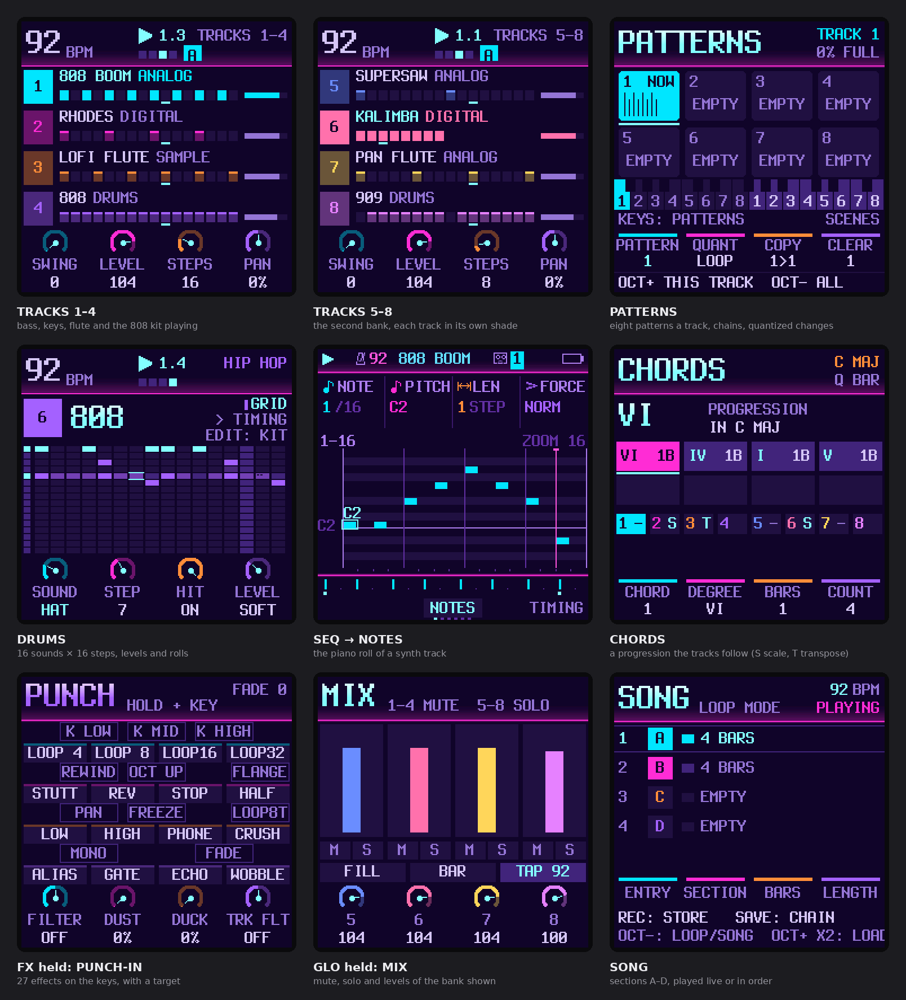
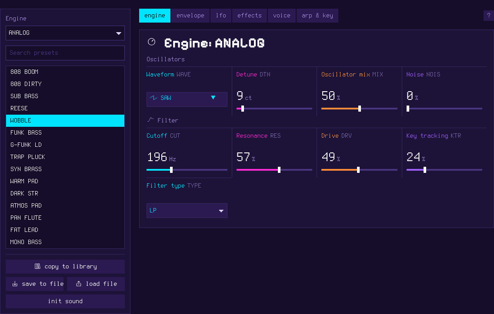

<b>A live groovebox firmware for the M-VAVE FM-1 — for any style.</b> 
Free and open source (GPL-3.0). A fork of <a href="https://github.com/isod89/sloop-fm1">SLOOP</a> by isod89, which is based on <a href="https://github.com/hugelton/Felucca">Felucca</a> by Leo Kuroshita / Hügelton Instruments.

<a href="https://josh-mcfarlin.github.io/boopbox/"><b>Website</b></a> ·
<a href="https://josh-mcfarlin.github.io/boopbox/webapp/installer/"><b>Install from the browser</b></a> ·
<a href="GUIDE.md">Complete guide</a> ·
<a href="BOOPBOX.md">Manual</a> ·
<a href="DEMARRAGE-RAPIDE-FR.md">Guide en français</a> ·
<a href="https://josh-mcfarlin.github.io/boopbox/webapp/editor/">Web editor</a> ·
<a href="https://josh-mcfarlin.github.io/boopbox/webapp/emu/">Try it in the browser</a> ·
<a href="../../releases">Releases</a> ·
<a href="CHANGELOG.md">Changelog</a> ·
<a href="../../issues">Report a bug</a>

---

BoopBox turns the FM-1 into an eight-track groovebox that you play live. At power-on, six tracks are synths and two are drum machines. You can change any track to the other type.

BoopBox has no factory patterns and no style of its own. You play everything that you hear. Use it for house, techno, hip-hop, trap, drum & bass, amapiano, synthwave, lo-fi, ambient, chiptune, and more.

**This README is a short overview.** For every button, page and setting, read [the complete guide](GUIDE.md).

## Contents

1. [Screenshots](#screenshots)
2. [Features](#features)
3. [Install](#install)
4. [Your first beat in 60 seconds](#your-first-beat-in-60-seconds)
5. [Compatibility](#compatibility)
6. [Troubleshooting](#troubleshooting)
7. [Specifications](#specifications)
8. [Documentation](#documentation)
9. [Building and tests](#building-and-tests)
10. [Contributing](#contributing)
11. [Credits and thanks](#credits-and-thanks)
12. [Licence](#licence)

---

## Screenshots

The screen of the FM-1 with eight tracks that play. The firmware's own code draws these images (<code>tools/make_screens.py</code>). See <a href="assets/screens/all/README.md">every screen of the firmware</a>.

The Sound page of the web editor: the envelope, the LFOs and the effects of the selected track.

## Features

Each item links to the section of the guide that gives the full details.

- **Live layers.** Hold a function button, and the white keys and knobs get a new job. The layers are punch-in effects, erase, note repeat, step entry, key and chords, mix, and song sections. [Guide §9](GUIDE.md#9-the-layers-one-by-one)
- **Drums.** Each drum track has 16 sounds on the white keys, with four hit levels and ratchets. There are 37 level-matched kits: 5 sampled and 32 synthesised. You can also make your own kits from samples or from the drum synth. [Guide §7](GUIDE.md#7-the-drum-track)
- **Sounds.** There are 223 level-matched presets on thirteen engines. The engines include analog, 4-op FM, 6-op FM with DX7 patches, physical models, noise, and the OBERVAVE polysynth. You get 32 slots for your own presets. [Guide §17](GUIDE.md#17-the-sounds-and-the-thirteen-engines)
- **Recording.** Press REC and play. BoopBox records on top of each pass (overdub) and corrects the delay of the keys. In free mode, the length of your first loop sets the tempo. [Guide §8](GUIDE.md#8-recording)
- **Sequencer.** Each track has 64 steps, with its own length and division. Each step can have parameter locks, micro timing and fill conditions. [Guide §10](GUIDE.md#10-the-step-sequencer-steps-nudge-locks-fills)
- **Songs.** Save up to four sections (A–D) and play them live on the next bar. You can record the song as you play it. [Guide §14](GUIDE.md#14-song-mode-sections-chains-songs)
- **Effects.** There are 27 punch-in effects that stay in time with the tempo. The master has DUST, DUCK, a DJ filter, a limiter and a TEXTURE bed. [Guide §18](GUIDE.md#18-effects-master-punch-in-per-track)
- **Your own samples.** Four slots of about 7.4 s each. The CHOP tool in the web editor cuts a recording of any length into parts. [Guide §23](GUIDE.md#23-your-own-samples-and-drum-kits)
- **MIDI.** USB MIDI in and out, the TRS MIDI IN jack, MIDI clock in, CCs, NRPN and MIDI LEARN. With USB HOST, a USB-MIDI keyboard can play BoopBox. [Guide §21](GUIDE.md#21-midi)
- **USB audio.** The FM-1 is a class-compliant USB audio input. Record its master output on a computer with no driver. [Guide §22](GUIDE.md#22-usb-audio)
- **Key velocity and aftertouch.** BoopBox can read how hard you press the keys. This function is off by default. [Guide §20](GUIDE.md#20-the-home-menu-and-the-lights)
- **Web editor.** Edit every sound, step and setting from Chrome or Edge, and make a full backup. The editor also works offline and as an app. [Guide §24](GUIDE.md#24-the-web-editor)
- **Safe updates and autosave.** The installer checks the package before it writes it. BoopBox saves your work 2.5 s after you stop, and starts again as you left it.

## Install

### From the browser (recommended)

1. On a computer, open **[the BoopBox installer](https://josh-mcfarlin.github.io/boopbox/webapp/installer/)** in **Chrome or Edge**.
2. Connect the FM-1 directly with a USB **data** cable. Do not use a hub.
3. Press **INSTALL**.
4. Allow MIDI access.
5. Wait for *Done*. The FM-1 starts again on the BoopBox logo.
6. Disconnect the FM-1 and connect it again one time. The computer then finds the USB audio input.

You do not need to download or compile anything. BoopBox keeps your projects, user presets, samples and settings.

### Other ways

- **Python:** get the `.fwsc` file of a [release](../../releases). Then run `python tools/fm1_install.py boopbox-X.Y.Z.fwsc`. This script needs `pip install mido python-rtmidi`.
- **Build it yourself:** see [Building and tests](#building-and-tests). On Windows, `INSTALL-BOOPBOX.bat` builds BoopBox and opens the installer locally.

### Going back

Before you go back, save a backup with the BoopBox web editor.

- **To SLOOP:** install the `.fwsc` file of SLOOP. Your samples, user presets and settings stay. SLOOP cannot open BoopBox projects, and its autosave can write over your work. When you come back to BoopBox, restore your backup.
- **To the official firmware:** use M-UPGRADE, the updater of M-VAVE, with the official FM-1 firmware. Close all other apps that use MIDI first. The steps are in [Guide §25](GUIDE.md#25-backup-rescue-going-back-troubleshooting).

### Rescue

- **If the FM-1 does not start BoopBox:** hold **OCT−** alone while you switch it on (*BoopBox USB RESCUE*). Then install again.
- **If an install stopped half-way:** the FM-1 stays in update mode. Press **INSTALL** again.
- **If the FM-1 does not start at all:** use [FM-1-transporter](https://github.com/kurogedelic/FM-1-transporter) to recover it.

> CAUTION: You install custom firmware at your own risk. There is no warranty.

## Your first beat in 60 seconds

1. Turn **ALGORITHM** to track **4**, which is orange. The white keys now play 16 drum sounds.
2. Turn **PRESETS** to select a kit. Try *808* or *BOOMBAP*.
3. Press **REC**, then play a beat at your own tempo.
4. For ghost notes, hold **OCT−** while you hit. For hard hits, hold **OCT+**.
5. Press **REC** on the "1" after your last bar. The loop closes, and its length sets the tempo.
6. Press **REC** again while it plays, and record on top.
7. For a hat roll, hold **ARP** and hold the hat key.
8. Turn **ALGORITHM** to track **1**. Press **REC** and play a bass line.
9. Hold **SEL** and press the key of your song.
10. On track 2, hold **SEL** and turn **KNOB 1** to *7TH*. Each white key now plays a chord.
11. Hold **FX** and press a key for a punch-in effect.
12. If you make a mistake, hold **EDIT** and press **OCT−** to undo it.

Next, read [the guide](GUIDE.md). Its [cheat sheet](GUIDE.md#26-cheat-sheet) shows every combination on one page.

## Compatibility

| | |
| --- | --- |
| Device | M-VAVE FM-1. You can put back the official firmware at any time. |
| Installer and editor | **Chrome or Edge** on Windows, macOS or Linux. They use Web MIDI with SysEx. |
| Cable | A USB **data** cable, connected directly (no hub) |
| USB audio | Any computer that accepts a class-compliant USB audio input (no driver) |
| MIDI IN jack | 3.5 mm TRS, through a TRS-to-DIN MIDI adapter (type A or B) |
| USB keyboards | Class-compliant USB-MIDI, with **USB HOST** on and a **powered hub**. The FM-1 does not supply power to the keyboard. |
| Not supported | Bluetooth MIDI and low-speed USB devices |

## Troubleshooting

**The installer or the editor does not find the FM-1.**
1. Use Chrome or Edge.
2. Use a data cable, and connect it directly (no hub).
3. Allow MIDI access.
4. Close all other apps and tabs that use MIDI, for example a DAW or M-UPGRADE.
5. Load the page again.

**The black keys make no sound on a synth track.** The track plays chords or a scale on the white keys. To play the black keys, hold **SEL** and set **KNOB 1 CHORD** to OFF. Then set **KNOB 3 KEYS** to OFF.

**The USB audio input does not show.**
1. Disconnect the FM-1 and connect it again.
2. On a Mac with macOS 15 or older, make sure that BoopBox is the latest version.
3. In Audacity, select Transport → Rescan Audio Devices.
4. On Windows, open Sound settings → Recording, and show the disabled devices.

**The USB recording is too quiet.** Set HOME menu → **USB AUDIO** to **FULL**, or turn MASTER up.

For more problems and solutions, read [Guide §25](GUIDE.md#25-backup-rescue-going-back-troubleshooting). If the guide does not solve the problem, [open an issue](../../issues). Tell us what you did, what you expected and what occurred. Also give the version from HOME menu → SYSTEM → ABOUT.

## Specifications

| | |
| --- | --- |
| Tracks | 8. At power-on, tracks 1–3 and 5–7 are synths, and tracks 4 and 8 are drums. |
| Sounds | 223 presets on 13 engines, including the 70 programs of OBERVAVE. 32 user presets. |
| FM6 | 6-op FM with DX7 SysEx import and a bank of 27 patches |
| Samples | 8 sampled sets (CC0) and 4 slots for your own samples (USR1–USR4) |
| Polyphony | 20 voices shared by the synth tracks, with a maximum of 8 for each track. The drums have 6 voices of their own. |
| Drum kits | 37 (5 sampled, 32 synthesised, 16 sounds each), plus your own sample kits and synth kits |
| Sequencer | 64 steps for each track, with its own length and division (1/32 to two bars). Chords, ties, slide, ratchets, 24 parameter locks for each track, micro timing, fill conditions and swing. One sample-accurate clock. |
| Recording | Live and overdub, quantised as you heard it. Free tempo or set tempo. 1, 2 or 4 bars. |
| Effects | 27 punch-in effects. Master DUST, DUCK, DJ filter, limiter and TEXTURE. For each track: drive, INSERT, slicer, and sends to chorus, delay and reverb. |
| Memory | Autosave, undo / redo, one song of 4 sections, 32 user presets, 27 FM6 patches, full backup and restore |
| Audio | 44.1 kHz fixed-point DSP. USB audio input at 44.1 or 48 kHz, 16-bit stereo. |
| MIDI | USB in and out, TRS MIDI IN (3.5 mm), MIDI clock in (USB or TRS) |
| Update | From the browser over USB (SHA-256 and CRC checks), with USB rescue |

## Documentation

- [GUIDE.md](GUIDE.md) — **the complete guide**: every button, combination, layer, page, engine and editor page, with a cheat sheet
- [BOOPBOX.md](BOOPBOX.md) — the manual: every page, layer, sound and kit
- [DEMARRAGE-RAPIDE-FR.md](DEMARRAGE-RAPIDE-FR.md) — guide de démarrage en français
- [CHANGELOG.md](CHANGELOG.md) — what changed in each release
- [BUILDING.md](BUILDING.md) — building, build options, the local audio preview, and tests
- [docs/NRPN.md](docs/NRPN.md) — the NRPN numbers and ranges
- [web/EDITOR_PROTOCOL.md](web/EDITOR_PROTOCOL.md) — the SysEx protocol of the editor
- [LICENSING.md](LICENSING.md) — the licences of the code and the assets

The version tags in the guides, for example *(2.6)*, show the SLOOP release that added a feature.

## Building and tests

For the full steps, read [BUILDING.md](BUILDING.md). You need the JieLi toolchain and three files of the AC79 SDK. Then:

- On Linux or macOS, run `./build.sh`.
- On Windows with WSL, run `INSTALL-BOOPBOX.bat`.

Both commands build the firmware and serve the installer and the editor on `http://localhost:8766`.

`tests/run_tests.sh` runs the host test suite with no hardware. The tests cover audio output, CPU budgets, sequencer timing, the UI, flash storage, the update loader, MIDI, USB audio and the web pages.

## Contributing

- **Bugs and ideas:** [open an issue](../../issues). Tell us what you did, what you expected and what occurred. Also give the version from HOME menu → SYSTEM → ABOUT.
- **Pull requests:** keep the style of the code around your change. Add a host test when you can. Make sure that `tests/run_tests.sh` passes. The release notes and the manual credit each contribution.
- **Licence:** when you contribute, you agree to release your code under GPL-3.0, as the rest of BoopBox is.

## Credits and thanks

- **[SLOOP](https://github.com/isod89/sloop-fm1)** by **isod89**. BoopBox is SLOOP with a new name, and it continues SLOOP. All the credits that SLOOP gave stay here.
- **[Felucca](https://github.com/hugelton/Felucca)** by **Leo Kuroshita** (@kurogedelic) / **Hügelton Instruments**. Felucca gave the engines, the sequencer, the editor and the installer. Later Felucca releases also gave:
  - In 2.3: the USB audio input, the MIDI clock, the knob reading and many fixes.
  - In 2.4: the FM6 engine and its DX7 patch editor (Felucca 1.0 / 1.0.1).
  - In 2.6: the INSERT effects, LFO 2 (SYNC / TRIG / POL), ENV SYNC, the ANALOG filter types, note LEN and step velocity, MIDI LEARN, the live drum mutes, the latched-arp fix (#191), the 1/4D delay, and REV / ECHO THROW (Felucca 1.4 / 1.4.1 / 1.5 / 1.5.1).
  - In 2.7: the arp modes REPEAT, DNUP, UP+8, CONV, DIVG, PINKY, THUMB, WALK and CHORD, and ORD in the order that you pressed the keys (Felucca 1.4 / 1.5.1).
- **The Felucca community, who asked for these features first** (Felucca discussions and issues): **Wulgaren** (insert effects with dry / wet, #78, and the arp report, #191), **etyrnal** (the lo-fi bit effect, #177, and envelopes in note values, #175), **benjaminguerrer** (LFO sync, #154), **gospodindilly-ops** (the ANALOG filter types, #104), **Armstrong1980** (#178) and **oMauNaProducer** (#173) (note length and step velocity), **lostfictions** and **planist79** (MIDI LEARN, #170).
- **@renebohne** — the key lights for played notes (pull request #11). In 2.6, MIDI Program Change (Felucca pull request #179). In 2.7, MIDI CC 74 controls the cutoff or brightness of each engine, after his pull request #71 (the standard CC map of Felucca 1.1.5).
- **ChanceTheMaker** and **keremimo** — the TRS MIDI input fix (Felucca Salt) and work on the MIDI clock.
- **andrerezemini** ([sloop-lab](https://github.com/andrerezemini/sloop-lab)) — in 2.7, the sound on the second core of the FM-1 and 38 KB of RAM back (pull request #111). This work starts from the dual-core start of **Charles Vestal** ([X0X](https://github.com/charlesvestal/fm1-x0x)) and **keremimo** ([Melodee](https://github.com/keremimo/melodee)).
- **juanjiant-bit** ([JIANT FM](https://github.com/juanjiant-bit/JIANT)):
  - In 2.7: the progressive knob acceleration (KNOB ACCEL) and the LEVEL / PAN glide.
  - In 1.8: the support for the flash chip of newer FM-1s, the NRPN map, the key velocity and aftertouch (its model, calibration and tests), and the idea of the browser emulator.
- **Charles Vestal** ([Velo](https://github.com/charlesvestal/fm1-velocity)) — in 1.8, the key velocity uses his discovery: how to drive and read the carbon key pills of the FM-1.
- **@ordenador** (Mario Faúndez Vidal) — the local audio preview of the web editor (pull request #120). It runs the engines and the sequencer of the firmware in the browser (WebAssembly), with a playable piano / pads and inline sequence editing.
- **Everyone who installed SLOOP, made music with it, sent comments, reported bugs or asked for features.** Most of each update comes from your messages. Some examples are parameter locks, DX7 patches, dotted delays and longer steps (2.4). In 2.6: a MIDI channel for each track, sustain and pitch bend, step entry from a MIDI keyboard, TEXTURE, the crackle fixes, the fix for the editor bug with the same value on two tracks, and the MIDI LEARN backup.
- **Assets.** Samples: Versilian Studios VSCO-2 CE and VCSL, Sonic Pi (all CC0). Font: Terminus and Terminus Bold (SIL OFL 1.1). Icons: Fukiai (MIT, Hügelton Instruments) in the web editor. `tools/gen_icon_art.py` and `tools/gen_logo.py` draw the parameter icons of the FM-1 and the BoopBox logo (GPL-3.0).
- **Engines.** PHASE engine after CrispyZebra (GPL). VOICE after klattsch (MIT). FM6: msfa from Dexed by Google Inc. and Pascal Gauthier (Apache-2.0).
- **Interface ideas** come from the step entry of Elektron and from the MPC of Akai (swing, note repeat, erase).

## Licence

The code is under GPL-3.0-only. See [LICENSE](LICENSE), and [LICENSING.md](LICENSING.md) for the assets. There is no warranty.

M-VAVE and FM-1 are trademarks of their owners. BoopBox is not affiliated with M-VAVE, Elektron or Akai. The author of SLOOP, Felucca and Hügelton Instruments do not endorse BoopBox. The names of the drum kits describe styles, not products.
