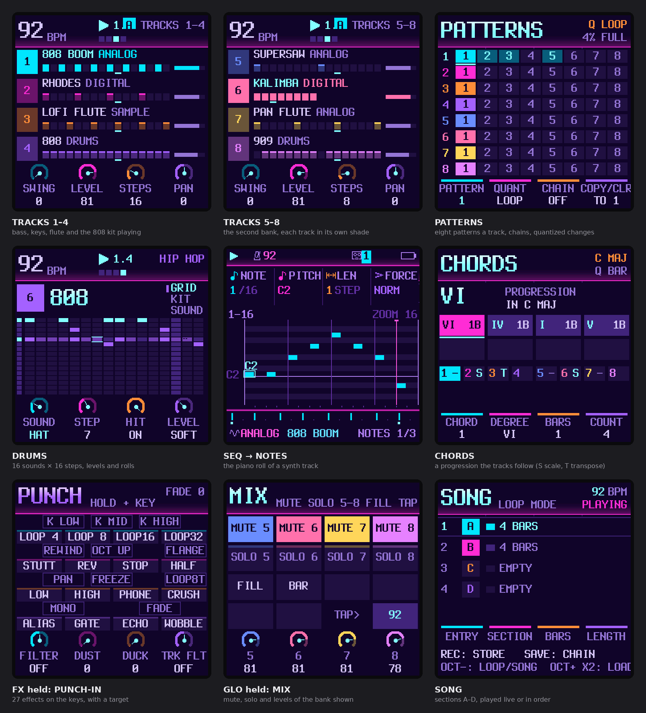
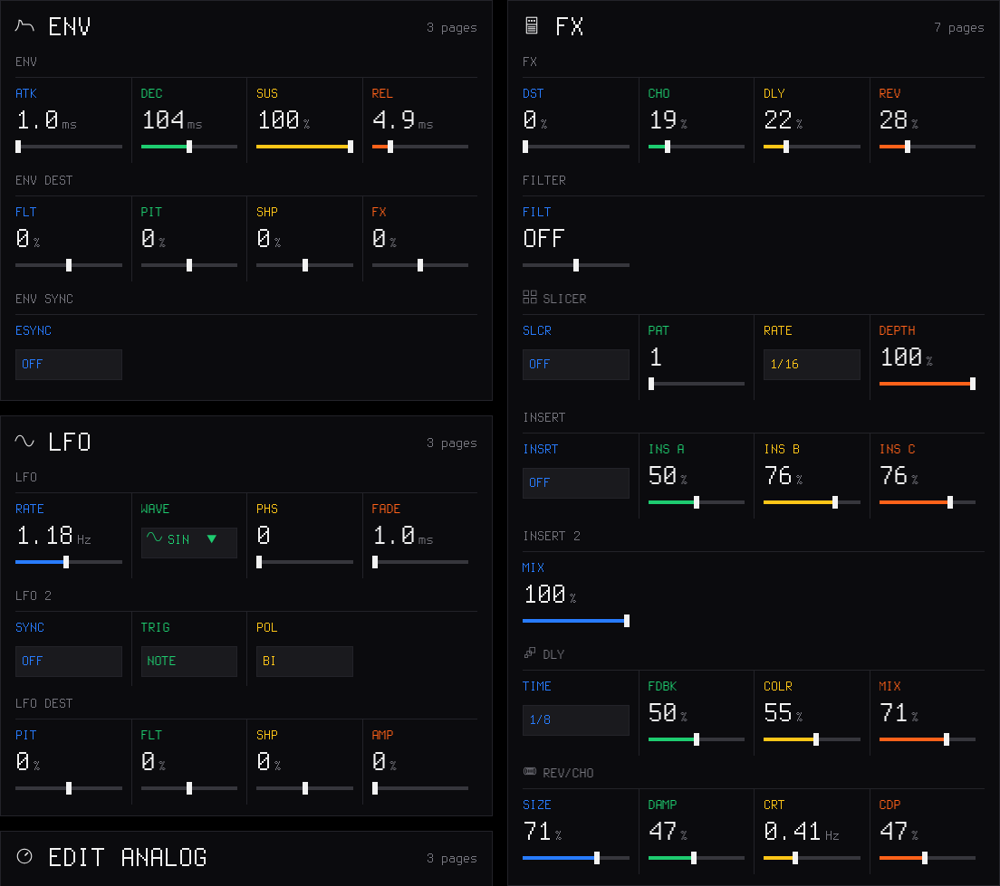
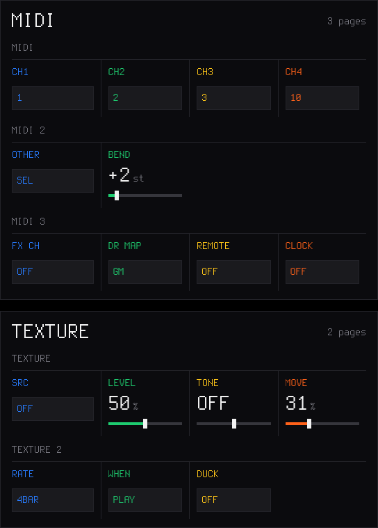
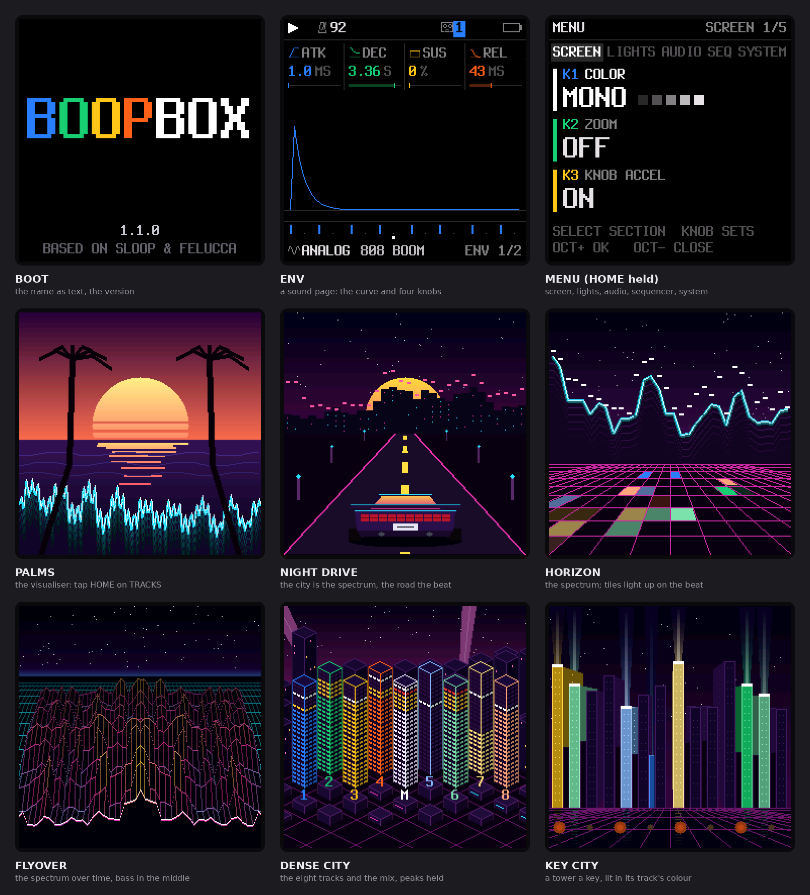
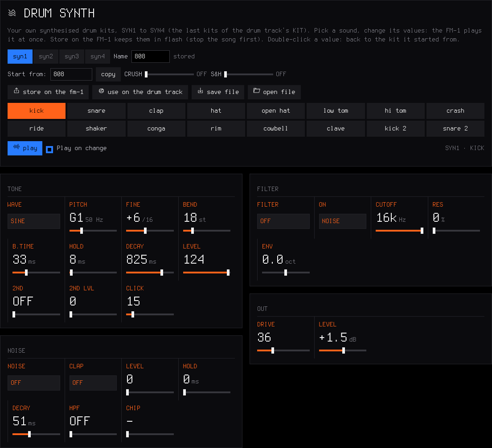
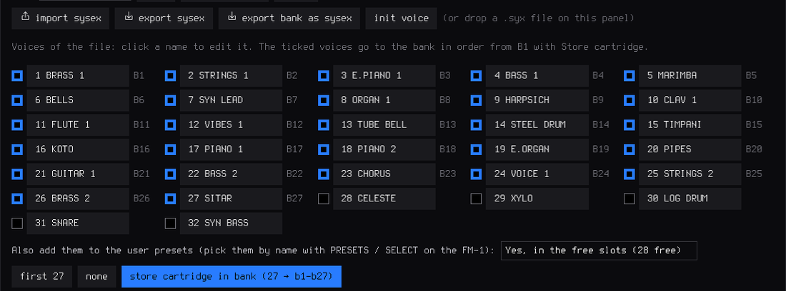
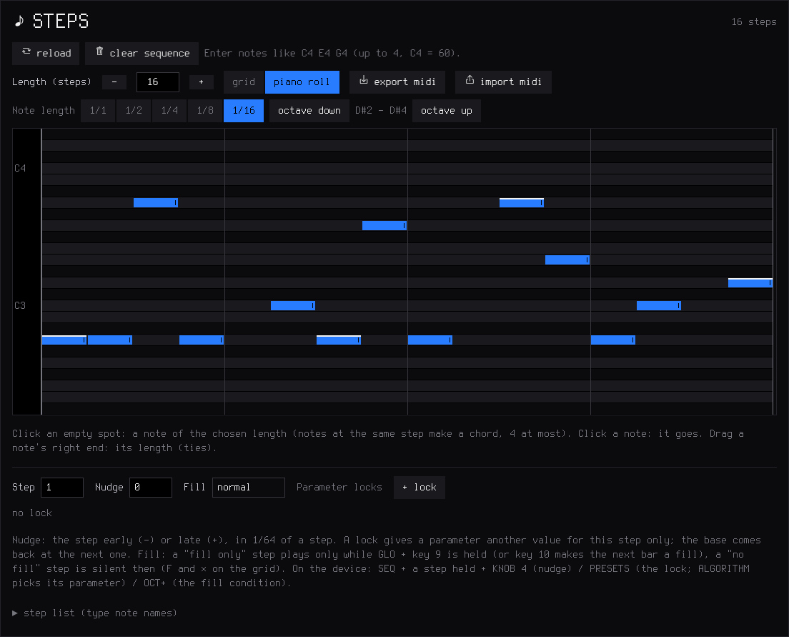
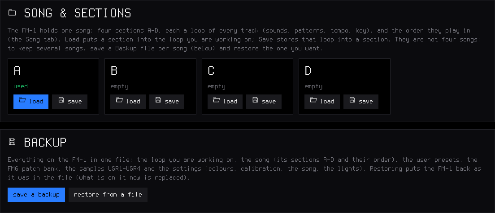

<b>A live groovebox firmware for the M-VAVE FM-1 — for any style.</b> 
Free and open source (GPL-3.0). A fork of <a href="https://github.com/isod89/sloop-fm1">SLOOP</a> by isod89, itself based on <a href="https://github.com/hugelton/Felucca">Felucca</a> by Leo Kuroshita / Hügelton Instruments.

<a href="https://josh-mcfarlin.github.io/boopbox/"><b>Install from the browser</b></a> ·
<a href="GUIDE.md">Complete guide</a> ·
<a href="BOOPBOX.md">Manual</a> ·
<a href="DEMARRAGE-RAPIDE-FR.md">Guide en français</a> ·
<a href="https://josh-mcfarlin.github.io/boopbox/webapp/editor/">Web editor</a> ·
<a href="../../releases">Releases</a> ·
<a href="../../issues">Report a bug</a>

---

> **BoopBox is a renamed fork of SLOOP.** Its versions start again at 1.0.0, which carries on from SLOOP 2.8.3. Projects, backups, songs, themes and presets from SLOOP open in BoopBox as they are, and the installer updates an FM-1 that runs SLOOP or Felucca. BoopBox is not affiliated with or endorsed by SLOOP's author, Felucca or Hügelton Instruments.

BoopBox turns the FM-1 into an eight-track groovebox you play live: **six synths and two drum machines** by default (any track can be either), each drum machine with 16 sounds on the white keys, twelve synthesis engines, 153 sounds, 37 drum kits, your own samples, a song mode you play with your hands, USB audio, MIDI in on the jack and MIDI clock — and now **physical models** (guitars, sitar, bells, hand drums), a **noise** engine, **six-operator FM with DX7 patches**, **parameter locks**, **micro timing**, **fills**, a **quick chain** of sections and the **sequencer to MIDI out**. House, techno, hip-hop, trap, drum & bass, amapiano, synthwave, lo-fi, ambient, chiptune — it does not pick a style for you. No factory patterns, nothing to load: everything you hear, you play.

> **Status:** 1.1.0, tested in the host simulator but **not yet on an FM-1**. Install it at your own risk, and please [report](../../issues) what you find. Your projects, presets, samples and settings are kept when you update, and you can go back at any time (see [Going back](#going-back)).

## Contents

1. [What's new in 1.1.0](#whats-new-in-110)
2. [Screenshots](#screenshots)
3. [Features](#features)
4. [Install](#install)
5. [Your first beat in 60 seconds](#your-first-beat-in-60-seconds)
6. [The controls](#the-controls)
7. [The menu: settings of the FM-1](#the-menu-settings-of-the-fm-1)
8. [MIDI and USB audio](#midi-and-usb-audio)
9. [The web editor](#the-web-editor)
10. [Compatibility](#compatibility)
11. [Troubleshooting](#troubleshooting)
12. [Specifications](#specifications)
13. [Documentation](#documentation)
14. [Building and tests](#building-and-tests)
15. [Contributing](#contributing)
16. [Credits and thanks](#credits-and-thanks)
17. [Licence](#licence)

---

## What's new in 1.1.0

- **A new visualiser.** Six scenes at sunset and in neon replace the twelve styles, all built in beside the web
  editor: PALMS (the mix's wave as the sea's front wave), NIGHT DRIVE (the spectrum as a city, a car on a road that
  runs with the beat, its lights flaring on the kick; stopped, it slows down and parks), HORIZON (the spectrum as a
  neon range over a floor that lights up on the beat in the tracks' colours), FLYOVER (the spectrum over time as a
  terrain), DENSE CITY (the eight tracks and the mix as towers of 24 floors with peak holds) and KEY CITY (a tower per
  key, lit in the colour of the track that plays it; a chord lights all its keys). See
  [the visualiser](BOOPBOX.md#the-visualiser).
- **SLOOP 2.8.4's fixes.** Clean fades (no distortion at the end of notes on the 3.5 mm output and USB), UNISON no
  longer stacks its voices in phase, PHYS strings in tune, NOISE's NZ ARCADE, SAMPLE and GRAIN follow the top keys,
  a firm press on a layer button opens its pages, on REC READY a knob changes only its own value, and more
  ([SLOOP's releases](https://github.com/isod89/sloop-fm1)).
- **Room in the flash.** Three tables (FM6's exponent, the sine, the screen font) are built in RAM when the FM-1
  starts instead of stored in the flash: byte for byte the same, so the sound and the screens do not change, and the
  build fits again with the fixes and the visualiser
  ([docs/groovebox-performance.md](docs/groovebox-performance.md)).
- Projects, backups, songs, presets and settings from 1.0.0 open as they are; the visualiser style kept with the
  settings opens as one of the new six.

**Not yet tested on an FM-1:** 1.1.0 is tested in the host simulator only (the firmware's own code on a computer).
Install it at your own risk, keep a backup, and please [report](../../issues) what you find.

## What's new in 1.0.0

- **BoopBox.** SLOOP 2.8.3 under its own name: the boot screen, the ABOUT page, the USB device (*BoopBox*;
  *BoopBox Update* while updating), the web editor and the installer. The installer also updates an FM-1 that runs
  SLOOP or Felucca, and the editor still finds one. Projects, backups, songs, themes and presets from SLOOP open as
  they are.
- **Eight tracks.** Six synths and two drum machines by default (tracks 4 and 8); any track can be either
  (SAVE → TOOLS → KIND). The screens show the bank of four the selected track is in (1–4 or 5–8). MIDI channels for
  tracks 5–8 (GLO → MIDI 4).
- **Each track its own colour.** Tracks 5–8 take a lighter shade of the colours of 1–4 (a darker one on a light
  theme), your own theme's too.
- **Patterns, step components, harmony, performance effects.** Eight patterns a track with chains and quantized
  changes (the PATTERNS screen); 14 step components; 32 parameter locks a track and SLIDE; the song's key, scale and a
  chord progression that tracks can follow (the CHORDS screen); punch-in effects with a target, latch and quantize.
  See [the groovebox controls](docs/groovebox-controls.md).
- **The visualiser,** with six styles: oscilloscope, spectrum, VU meters, circle, bounce, wires (tap HOME on TRACKS).
- **Its own art:** a new logo, the parameter icons and the synthesized drums are drawn and made by code in this
  repository (GPL-3.0); see [LICENSING.md](LICENSING.md).
- **Left out to fit the flash:** six of the visualiser's twelve styles, the bitmap boot logo (the boot screen shows the
  name as text) and the top recording of the BASS sample set
  ([docs/groovebox-status.md](docs/groovebox-status.md)).
- **Known limits:** the web editor shows tracks 1–4 only (its LIVE page and track list) and does not edit patterns 2–8,
  step components or the chord progression (backups keep them).

Version tags such as *(2.6)* in the guides mark the SLOOP release that brought a feature; SLOOP's own release history
is in [its repository](https://github.com/isod89/sloop-fm1).

## Screenshots

The FM-1's screen in 1.1.0, eight tracks playing: both banks of tracks, the patterns, the drum grid, the piano roll, a chord progression, the punch-in effects, the mix layer of tracks 5–8 and the song. Drawn by the firmware's own code (<code>tools/make_screens.py</code>).

The web editor's Sound page: the envelope, the LFOs and the effects of the selected track (<code>tools/make_editor_screens.mjs</code>).

Settings: the MIDI channels, the bend range and the TEXTURE bed.

The boot screen, a sound page (ENV), the menu, and the visualiser's six styles (tap HOME on the TRACKS screen).

The web editor's Drum synth page: every value of every drum sound, heard on the FM-1 at once.

A 32-voice DX7 cartridge dropped on the FM6 panel: 27 voices ticked, into the bank in one write, and as user presets if you choose.

The piano roll: draw, delete and stretch notes and chords with the mouse; Export MIDI / Import MIDI next to it.

## Features

### Play it live: hold a button, touch a key

Every function button is a **layer**: hold it and the 16 white keys and the four knobs change job, and the screen shows how. Tap it and its pages open. Hold a layer button and tap HOME to **lock** it open, both hands free.

| Hold | The white keys | KNOB 1 · 2 · 3 · 4 |
| --- | --- | --- |
| **FX** — punch | 27 punch-in effects on the whole mix. White keys: loops 1/4–1/32, stutter, reverse, tape stop, half speed, filter sweeps, phone, bit crush, alias, gate, echo, tape wobble. Black keys (2.6): kill low / mid / high, rewind, octave up, flanger, auto-pan, freeze, loop 1/8T, mono, fade out | FILTER · DUST · DUCK · the track's filter |
| **EDIT** — erase | erase a sound or a note as the loop plays (stopped: from the whole pattern); a black key: live drum mutes (2.6) | SHIFT · LENGTH ×2 / ½ · TRANSPOSE |
| **ARP** — roll | note repeat on the grid, recorded as ratchets | RATE (1/8 … 1/64) |
| **SEQ** — steps | the 16 steps of the page; a step held: a level, a ratchet, a nudge, parameter locks (PRESETS / ALGORITHM), a fill condition (OCT+) | SOUND / NOTE · DIV · SWING · LENGTH (a step held: SOUND / NOTE · LEVEL or, synths, VELOCITY · RATCHET · NUDGE) |
| **SEL** — key | the key of the song | CHORD · SCALE · KEYS · TRANSPOSE |
| **GLO** — mix | 1–4 mute, 5–8 solo, 9 fill (held), 10 fill on the next bar, 16 tap tempo; F#3: MIDI LEARN (2.6) | the levels of tracks 1–4 |
| **SAVE** — song | 1–4 play sections A–D (several tapped while held: a quick chain), 5–8 save the loop into them, 13 loop / song, 14 record the song, 16 the chain | — |

Keys 1, 5, 9 and 13 glow dimly while a layer is held: the first key of each row of the 4 × 4 grid on the screen. **EDIT + OCT− / OCT+** is undo / redo.

### Drums

- **16 sounds on the white keys**, kick to cowbell; a black key doubles the white key on its left (fast rolls with two fingers).
- **Ghost and hard hits:** hold OCT− / OCT+ while you play. Every hit keeps its level (GHOST, SOFT, NORM, HARD) and a **ratchet** (x1–x4).
- **37 kits**, all level-matched: a sampled acoustic kit in 5 treatments (CC0 studio recordings) and 32 synthesised kits — 808, 909, 606, 80s, vintage, trap, drill, boom bap, lo-fi, phonk, house, deep house, techno, minimal, electro, disco, UK garage, jungle, dubstep, reggaeton, amapiano, afrobeat, latin, tribal, synthwave, chiptune, arcade, glitch, industrial, hyperpop, ambient, jazz brushes. Each synthesised sound is built like on the classic machines; softer hits are darker as well as quieter. **Your own kits** too (2.4): KIT USR1–USR4 (or USR3+4, about 15 s) plays sample slots you fill in the editor's Drum kit page, a sound of yours per lane. And (2.5) **SYN1–SYN4**, synthesised kits you make in the editor's Drum synth page.
- **Grid and kit pages** on the FM-1 (EDIT or SEQ on the drum track): on the grid, the keys are the steps of the sound you pick (and you hear it); a 16-lane grid in the web editor.

### Synths and sounds

- **Twelve engines:** analog, 4-op FM, **6-op FM with DX7 patches (FM6, 2.4)**, phase distortion, three-oscillator, tonewheel organ, formant voice, granular, lo-fi chip, sampler, **physical models (PHYS, 2.5)**, **noise (NOISE, 2.5)**.
- **153 sounds, browsed by kind** — basses (sliding 808s, acid 303, reese, FM, bass guitar), guitars, sitar and koto (physical models), keys (Rhodes, a real Steinway grand, house and afro keys), organs and accordion, pads (string machine, granular clouds), leads (supersaw, talkbox, pan flute, harmonica), plucks and bells (harp, steel drum, glockenspiel, celesta, xylophone), stabs and dub chords — every one level-matched. **32 slots** for your own presets.
- Envelopes (with a pitch punch for 808s; 2.6: in note values with ENV SYNC), LFO (2.6: tempo-synced, free-running or unipolar), arpeggiator, glide and voice modes (POLY, MONO, LEGATO, UNISON), per-track drive, **INSERT effect** (2.6: soft / hard clip, wavefolder, fuzz, bit crush, phaser, flanger, chorus) and slicer, ANALOG's filter as LP, BP or HP (2.6), sends to a **stereo chorus**, a **tempo delay** (dotted 1/8 and 1/16 too) and a **stereo reverb**.
- **Key and chords (SEL):** the key of the song for all synths, 16 scales, one-key chords (triad, 7th, 9th, sus4, power), keys snapped to the scale or the scale on the white keys.

### Recording and the sequencer

- **Records as you play, no click needed:** while it plays, REC records at once and every pass is added on top (overdub). Notes land where you heard them: the ~12 ms of the keys are taken back.
- **The REC screen (2.3):** **mode** *free* — no tempo, no grid: play, press REC on the "1" after your last bar, and the loop's length sets the tempo — or *tempo* — record at the tempo you set; **length** 1, 2 or 4 bars; **start** on your first note, or after a one-bar **count-in**.
- **Hold REC ~2 s** to clear a track; **undo / redo** brings it back.
- **64 steps per track**, each track with its own length and division, 1/32 to two bars (polymeters stay in phase); chords up to 4 notes a step, ties, slide; **MPC swing**, 0 (straight) to 100; one sample-accurate clock for everything: no drift at any tempo.
- **Parameter locks, micro timing and fills (2.4):** hold a step to give it its own value of any sound parameter, to nudge it off the grid, or to make it play only (or never) during a fill.
- The PLAY light flashes on every beat (a visual metronome); an audible click is in GLO → GLOBAL → CLICK and is never recorded.

### Songs

Save up to four sections **A–D** (SAVE + keys 5–8), play them live on the next bar (SAVE + keys 1–4), and **record the song as you play it** (SAVE + key 14). Keep SAVE held and tap several sections for a **quick chain** (2.4). In song mode PLAY plays the whole chain. The SONG screen edits it by hand.

### Effects and master

- **27 punch-in effects** (FX + a key, white or black), locked to the tempo: DJ kills, rewind, reverb freeze and more.
- **Master:** **DUST** (an old sampler and a record: bits, rate, crackle), **DUCK** (the kick pumps the synths), **FILT** (a DJ filter: low-pass ← off → high-pass), and an output limiter.
- **TEXTURE (2.6):** a looping bed under the mix: vinyl, tape, rain, wind, radio, room tone or one of your samples, with level, tone and a slow breath over 1–16 bars.

### Your own samples

- **Four slots** (USR1–USR4) of about 7.4 s each, played by a synth track or as a drum kit (USR3+4: one kit of about 15 s); up to 16 WAV files per slot, each on its own key.
- **CHOP** in the web editor: open or drop a recording (WAV, MP3, AIFF…) of **any length**, tap along while it plays (each tap snaps to its hit), or find the hits, a tempo grid, equal parts; keep the chops you want, shorten them or **Fit to slot**; send them to a slot, one per key, or download them as WAV files.

### MIDI

- **USB MIDI** in and out, class compliant.
- **TRS MIDI IN** (the 3.5 mm jack, 2.3) for a keyboard or a pad controller.
- **MIDI clock in** (USB or TRS): tempo, START, CONTINUE, STOP.
- **MIDI CCs** (2.5): level, pan, filter, resonance, envelope, glide and the sends from a controller's knobs; **MIDI LEARN** (2.6): any knob of yours onto any parameter of a track.
- **MIDI out:** the keys always; the sequencer, the arp and the rolls too with GLO → MIDI 2 → OUT = SEQ (2.4).
- Details: [MIDI and USB audio](#midi-and-usb-audio).

### USB audio (2.3)

The FM-1 is also a **USB audio input**: record its master output on a computer, no driver, over the same cable as MIDI and the editor. Details: [USB audio](#usb-audio-record-the-fm-1-on-a-computer).

### Lights for playing in the dark (2.3)

Every button can glow so its label is readable on a black FM-1; the C keys or every white key can glow too; the notes playing can light their keys. Details: [The menu](#the-menu-settings-of-the-fm-1).

### Memory and safety

- **Autosave:** stop and leave it 2.5 s, your work is kept; at power-on BoopBox comes back exactly as you left it.
- **1 song of 4 sections (A–D)** (more songs as backup files), **32 user presets**, **27 FM6 patches**, **undo / redo**.
- **Full backup and restore** from the web editor (2.3).
- **Safe updates:** the installer checks the package (SHA-256) before writing it, the update loader checks it again (CRC) before starting it; an interrupted install finishes when you press Install again; **USB rescue** (OCT− at power-on).

## Install

### From the browser (recommended)

1. Open **[the BoopBox installer](https://josh-mcfarlin.github.io/boopbox/)** in **Chrome or Edge** on a computer.
2. Connect the FM-1 by USB — a **data** cable, directly (no hub).
3. Press **INSTALL**, allow MIDI access, and wait for *Done*. The FM-1 restarts on the BoopBox logo.

Nothing to download or compile. Your projects, user presets, samples and settings are kept. After an install, **unplug and plug the FM-1 back in** once so the computer finds its USB audio input.

### Other ways

- **Python:** the `.fwsc` of a [release](../../releases) with `python tools/fm1_install.py boopbox-2.4.fwsc` (needs `pip install mido python-rtmidi`).
- **Build it yourself:** see [Building and tests](#building-and-tests); on Windows, `INSTALL-BOOPBOX.bat` builds BoopBox and opens the installer locally.

### Going back

- **To an earlier BoopBox:** install the `.fwsc` of its [release](../../releases) (for example [2.3](../../releases/tag/v2.3)). Your samples, user presets and settings stay. **Projects saved by 2.4** (format FUN5: locks, nudges, fills) **do not open in 2.3 or older** — 2.3 sees them as empty, and its autosave can write over the music in progress; a 2.4 backup restores into 2.4 only. **Save a backup before you go back**, and restore it once you are on 2.4 again.
- **To the official firmware:** on the installer page, open **Return to the official firmware (V15)**. Save a backup with the editor first, download FM-1 V15 from m-vave.com and select its `FM-1.fwsc` — only that exact file is accepted. M-VAVE's updater, M-UPGRADE, works too. To come back, install BoopBox again and restore your backup.

### Rescue

- **The FM-1 no longer starts BoopBox:** hold **OCT−** alone while switching it on (*BoopBox USB RESCUE*), then install again.
- **An install was cut off:** the FM-1 stays in update mode; press INSTALL again and it finishes.
- If an FM-1 no longer starts at all, recovery needs [FM-1-transporter](https://github.com/kurogedelic/FM-1-transporter).

> Custom firmware is installed at your own risk. No warranty.

## Your first beat in 60 seconds

1. **ALGORITHM** to track **4** (orange, drums). The white keys are 16 drum sounds; **PRESETS** picks a kit (try *808* or *BOOMBAP*).
2. Press **REC** and play a beat freely, at your own tempo. Hold **OCT−** while you hit for ghost notes, **OCT+** for hard ones.
3. **Press REC on the "1" after your last bar.** The loop closes, its length sets the tempo, the hits snap to the grid and it plays at once. (Prefer a set tempo, or a count-in? Turn KNOB 1 and KNOB 3 on the REC screen before you start.)
4. **REC** again while it plays: you record on top. Hold **ARP** and hold the hat key for a hat roll.
5. **ALGORITHM** to track **1**, **REC**, play a bass line. Hold **SEL** and press the key of your song; on track 2, hold SEL and turn **KNOB 1** to *7TH*: every white key now plays a chord.
6. Hold **FX** and press a key (white or black) for a punch-in effect; still holding FX, turn **KNOB 2** for DUST, **KNOB 3** for DUCK.
7. A mistake? Hold **EDIT** and press **OCT−**: undo.

## The controls

| Control | What it does |
| --- | --- |
| **MASTER** | volume (and the USB audio level, if USB AUDIO is on MASTER) |
| **SELECT** | on HOME and inside a layer: tempo · on a page: the previous / next page of its group · DRUMS: grid / kit |
| **ALGORITHM** | the selected track: 1 · 2 · 3 (synths) · 4 (drums) |
| **PRESETS** | the selected track's sound, or the drum kit |
| **KNOB 1–4** | what the four dials at the bottom of the screen show, each in its colour |
| **OCT− / OCT+** | octave (both: back to 0) · on the drum track, held: ghost / hard hits |
| **FX · SEL · ENV · LFO · EDIT · GLO** (top row) | tap: their pages · hold FX, SEL, EDIT, GLO: a layer. **SEL** is the second button of the top row, between FX and ENV (not the SELECT knob) |
| **HOME** | the TRACKS screen · on it: the full-screen visualiser (SELECT: 6 styles; HOME again closes it) · hold: the menu · tapped while a layer is held: lock it |
| **SAVE** | on TRACKS: the SONG screen · elsewhere: the SAVE pages · hold: the song layer |
| **ARP · SEQ** | tap: their pages · hold: note repeat · steps |
| **PLAY** | start / stop all the tracks; its light flashes on every beat |
| **REC** | playing: record now / stop · stopped: arm (the REC screen) · hold: clear the track |
| **EDIT + OCT− / OCT+** | undo / redo |

Colours: **blue** track 1 and KNOB 1, **green** 2, **yellow** 3, **orange** 4 (drums). White is what you touch; red is recording.

## The menu: settings of the FM-1

Hold **HOME**. The menu is in four sections, as the pages are: **SCREEN** (COLOR, ZOOM, KNOB ACCEL), **LIGHTS** (LIGHTS, KEYS, NOTES), **AUDIO** (LOWCUT, USB AUDIO, USB RATE; 2.6: USB SERIAL), **SYSTEM** (HARDWARE CALIBRATION, ABOUT). **SELECT** goes from one section to the next, **KNOB 1, 2, 3** set the section's rows (each row shows its knob's colour), **PRESETS** moves the cursor, **OCT+** steps the cursor's setting round or opens it (CALIBRATION, ABOUT), **OCT−** closes. These are settings of the FM-1, not of a project: loading a project or NEW PROJECT does not change them, and the backup keeps them.

| Item | Choices | What it does |
| --- | --- | --- |
| **COLOR** (SCREEN) | 5 palettes, then your theme (2.7) | the screen's colours; your own made on the editor's Theme page (and shared as one line of text) |
| **ZOOM** (SCREEN) | OFF / ON | a large readout of the value you turn |
| **KNOB ACCEL** (SCREEN, 2.7) | ON / OFF | ON: a fast turn sweeps wider, progressively (after JIANT FM); OFF: one value a detent |
| **LIGHTS** (LIGHTS) | OFF / LOW / MID / HIGH | every button glows at that level; what is active stays at full light |
| **KEYS** | OFF / C KEYS / WHITE KEYS / ALL KEYS | the C keys, every white key, or every key glow too |
| **NOTES** | OFF / ON | the notes playing on the selected synth track light their keys (sequencer notes too, at least a tenth of a second each), on every page and in every layer |
| **SPEAKER LOWCUT** (AUDIO) | OFF / ON | a low cut for the small built-in speaker |
| **USB AUDIO** | MASTER / FULL | the level of the USB audio input: follows the MASTER knob, or a fixed full level |
| **USB SERIAL** (2.6 only) | OFF / ON | a serial console for developers; OFF (default) so macOS 13–15 show the USB audio input; at the next start. From 2.7 not in the FM-1's build (the flash is full) |
| **USB RATE** (2.7) | AUTO / 44.1 KHZ / 48 KHZ | the rates the USB audio input offers; 44.1 KHZ if a phone records it distorted; at the next start |
| **HARDWARE CALIBRATION** (SYSTEM) | | the panel table, if a key or a knob answers wrongly |
| **ABOUT** | | the version (*SLOOP 2.4*) and its build date, the credits |

Two more settings of the FM-1 live elsewhere: **SYNC** (GLO → SYSTEM: INT, USB or TRS) and the REC screen's **mode** and **start**.

## MIDI and USB audio

### MIDI in

BoopBox takes MIDI from two places at once:

- **The MIDI IN jack** (3.5 mm TRS): a keyboard or a pad controller with a MIDI output, through a **TRS-to-DIN MIDI adapter**. If nothing plays, try the other adapter type (A / B).
- **USB**, from a computer or a phone (a DAW, a MIDI routing app) or a USB MIDI host box.

| MIDI channel | Plays |
| --- | --- |
| 1, 2, 3 | synth tracks 1, 2, 3 (2.6: GLO → MIDI → CH1, CH2, CH3 set any channel for each) |
| 10 | the drum track (the nearest of its 16 sounds; GLO → MIDI → CH4 changes the channel) |
| the others | the selected track: set your keyboard to channel 4 and it follows ALGORITHM (2.6: GLO → MIDI → OTHER = OFF ignores them) |

**Your own channels (2.6).** For an external sequencer with its own channels (drums 10, bass 2, pad 11, lead 8…): GLO → **MIDI** sets each track's channel (CH1, CH2, CH3, CH4 the drums: OFF or 1–16, in and out; two tracks never share one) and GLO → **MIDI 2** the rest: **IN**, **OTHER** (SEL: the channels no track has play the selected track; OFF: ignored), **OUT**, **BEND**. Notes, CCs and MIDI out follow. Settings of the FM-1, kept through power-off.

Your sequencer uses the other channels for other gear? GLO → MIDI 2 → **IN = CH 1 … CH 16** (2.6): BoopBox then answers that one channel only, on the selected track, and ignores the rest.

A USB keyboard plugged **straight into the FM-1** cannot work: both are USB devices, and a USB link needs a host (a computer, a phone, or a USB MIDI host box). Bluetooth MIDI is not supported: BoopBox, like Felucca, never switches the radio on.

### MIDI out

What you play on the keys always goes out on USB MIDI, each track on its channel (1–3 the synths, 10 the drums). GLO → MIDI 2 (or SYSTEM) → **OUT** = **SEQ** sends what the sequencer, the arp and the rolls play too: every note is ended, STOP ends whatever was still on, and notes that came in from a computer or the jack are never sent back. Record the FM-1's MIDI in a DAW and you get your pattern as notes.

### MIDI clock in

GLO → SYSTEM → **SYNC** = **USB** or **TRS** (INT: BoopBox's own tempo). START plays from the top, CONTINUE carries on, STOP stops; the tempo follows the master and the steps follow its 24 pulses a beat, so BoopBox never drifts. When the clock stops for half a second, PLAY on the FM-1 plays at its own tempo again.

**Clock only (2.4):** GLO → MIDI 2 → **IN** = **CLOCK**: BoopBox follows the clock and ignores incoming notes (and CCs), handy when a DAW or a sequencer also sends notes to other gear.

### MIDI CCs (2.5)

The knobs of a MIDI controller set the sound, on the track the channel plays (as the notes: 1–3 the synths, 10 the drums, 4–16 the selected track). A CC sets its parameter as a knob would, 0–127 over its range. The standard map of Felucca 1.1.5:

| CC | Sets |
| --- | --- |
| 5 | GLIDE |
| 7 | LEVEL (on the drum channel: GLO → DRUMS → LVL) |
| 10 | PAN |
| 71 | the engine's resonance (RES or Q: ANALOG, TRIO, VOICE, NOISE; the others ignore it) |
| 72 · 73 · 75 | release · attack · decay |
| 74 | the track's FILTER: 64 off, lower a low-pass, higher a high-pass (every engine, the drums too) |
| 91 · 93 · 94 | the reverb, chorus and delay sends (on the drum channel 91 and 94 are GLO → DRUMS → REV and DLY) |

Other CCs (mod wheel…) are ignored. From 2.6 the **sustain pedal** (CC 64) and **pitch bend** work too (the bend's range: GLO → MIDI 2 → BEND, 1–12 semitones).

**MIDI LEARN** (2.6, after Felucca 1.5): **GLO + F#3**, turn the knob of BoopBox you want, move a knob of your controller; GLO + F#3 again to finish. A learned CC sets that track's parameter on any channel, in place of the map above (up to 16; kept through power-off). HOME menu → SYSTEM → **MIDI LEARN CLEAR** forgets them. Details: [GUIDE.md](GUIDE.md#midi-learn-26).

### USB audio: record the FM-1 on a computer

On USB the FM-1 is also an **audio input named "BoopBox"**: 44.1 or 48 kHz (2.5: phones and apps that only take 48 kHz), 16-bit stereo, class compliant — no driver on Windows, macOS or Linux. Choose it in your DAW or in Audacity and record: you get the master output, exactly what the headphones play (after DUST, DUCK and FILT). MIDI, the web editor and the installer keep working on the same cable.

- **The level:** HOME menu → **USB AUDIO**. **MASTER** (default): the recording follows the MASTER knob, as the headphones do — keep MASTER well up while you record. **FULL**: a fixed level, as with MASTER all the way up, kept from clipping by the limiter; MASTER then only sets the headphones (the right choice for an interface with no level control).
- **The first time** (and after an install), the computer sets the FM-1 up again as a MIDI + audio device: unplug and plug it back in if the input does not show. The MIDI port keeps its name.
- The audio input comes from Felucca 1.0.

## The web editor

Open it from the [installer page](https://josh-mcfarlin.github.io/boopbox/) (or the [editor link](https://josh-mcfarlin.github.io/boopbox/webapp/editor/)) in Chrome or Edge, with the FM-1 on USB, and press **Connect**. It follows the device live: turn a knob on the FM-1 and the editor moves.

**Local audio preview.** Build the browser audio engine with `python3 tools/build_preview.py`
(Emscripten required; see [BUILDING.md](BUILDING.md#browser-audio-preview)), generate and serve the local site,
then open `http://localhost:8766/webapp/editor/?mock=1`. Press **Connect** and **Play loop**
to hear the current four-track loop. Presets, sound parameters, tempo, mixer, steps, locks, FM6 patches and
uploaded samples feed the actual firmware DSP compiled to WebAssembly, running in an AudioWorklet at 44.1 kHz.
The preview starts collapsed so the sound editor stays visible. Its compact bar keeps **Play loop** and
**Stop**, plus the selected sound and its live step/note. **Show preview** opens the piano/pads, volume
and sequence; **Hide preview** folds them again while the loop keeps playing. Sound parameters remain
editable during playback in either view.
Click the notes or play **A W S E D F T G Y H U J K**; **Space** toggles the sequencer, **Stop** releases all notes,
and **Volume** adjusts browser output. **Current sequence** shows all four patterns with the actual audio
engine's playing step highlighted, independently following each track's length and division. Patterns over
16 steps follow automatically. Click a synth step to enable or disable it: re-enabling keeps its previous
notes, velocity, levels and ratchets. Double-click a synth step to open a piano picker: click a key,
use **− / +** to browse octaves, then **Apply** to change the pitch (or **Cancel** to keep it).
**Listen on click** auditions the draft through that track's instrument without saving it to the sequence.
For chords, select a member above the piano and change its pitch. An empty
step uses the new note chosen beside its track or by playing its piano. Drum rows show individual percussion sounds: click a cell to toggle
that hit while keeping the other sounds on the same step. Drums start as a compact overview of hits per
step; **Show drum grid** (or clicking an overview step) expands the editable sound rows, and **Hide drum
grid** collapses them without changing the pattern or interrupting playback. Common and programmed sounds stay visible;
**Show all 16 sounds** reveals the rest. Edits reach the playing loop through the editor protocol.
**Follow playback** and the page arrows control which 16 steps are shown; paging pauses under the pointer
or keyboard focus so a click keeps its target. **Full editor** opens the detailed sequencer (including
chords and ties). **Hide keys/pads** saves space.
The simulated device stays still until you edit it; its changes are kept
only for the current page session. This mode makes no MIDI requests and does not connect to or update an FM-1.
It previews the current project loop; the saved Song section order and hardware recording are not emulated.
Audio preview requires the served site, rather than the downloaded single-file editor.

**Offline (2.6).** *Download the editor* (under Connect, or on the installer page) saves the whole editor as one file for a computer, `boopbox-editor-2.6.html`, also attached to each [release](https://github.com/josh-mcfarlin/boopbox/releases). Double-click it: it opens in Chrome or Edge without internet (Chrome asks once to allow MIDI) and works as the online one. Its sound library (kept in the browser) is its own, apart from the online editor's: move sounds between them with Export / Import, or a backup.

**As an app, also on Android (2.6).** Open the [online editor](https://josh-mcfarlin.github.io/boopbox/webapp/editor/) or the installer once with internet, then *Install the app* (under Connect, or on the installer page; or Chrome's menu → *Install app* / *Add to Home screen*). From then on the BoopBox app opens the editor without internet, and its link to the installer works offline too (with the firmware it installs). It stays the online site kept by the browser, so it uses the same sound library as the online editor, and it takes each new BoopBox version by itself the next time it opens online. On Android, use the app rather than the downloaded file: Chrome on Android does not allow MIDI in a downloaded file.

- **Sound** — every parameter of the selected track, the engines and the presets; on an FM6 track the **FM6** panel: every operator, the bank, **Import / Export SysEx** (DX7 voices and banks).
- **Sequencer** — the steps, as tiles or as a **piano roll**, and the track's length (1–64 steps); on the drum track a grid of 16 sounds × the steps, with levels and ratchets, and the kit. Click a step for its nudge, parameter locks and fill condition. **Export MIDI / Import MIDI**: the selected track as a MIDI file, and back.
- **Tracks** — the four channel strips.
- **Song** — the order of the sections A–D (the SONG screen): which section, how many bars, how many times, and whether the song starts again at the end.
- **Library** — your user presets and preset files.
- **Samples** — the three user slots, files and **CHOP**.
- **Drum synth** (2.5) — your own synthesised kits SYN1–SYN4: every value of every drum sound, heard at once.
- **Song & sections** — the sections A–D, and **Backup** (one file per song): *Save a backup* writes everything on the FM-1 to one file (with the FM6 bank); *Restore from a file* puts it all back (stop playback first).
- **Settings** — global, master (DUST, DUCK, FILT, ROLL), drums.

The protocol is documented in [web/EDITOR_PROTOCOL.md](web/EDITOR_PROTOCOL.md).

## Compatibility

| | |
| --- | --- |
| Device | M-VAVE FM-1 (the official firmware can be put back at any time) |
| Installer and editor | **Chrome or Edge** on Windows, macOS or Linux (they use Web MIDI with SysEx) |
| Cable | a USB **data** cable, plugged directly (no hub) |
| USB audio | any computer that takes a class-compliant USB audio input (no driver) |
| MIDI IN jack | 3.5 mm TRS, through a TRS-to-DIN MIDI adapter (type A or B) |
| Not supported | Bluetooth MIDI; a USB keyboard plugged straight into the FM-1 |

## Troubleshooting

**The installer or the editor does not find the FM-1.** Use Chrome or Edge, a data cable, no hub, and allow MIDI access. Close every other app or tab that uses MIDI (a DAW, M-UPGRADE, another editor tab), then reload the page.

**An install stopped half-way.** The FM-1 waits in update mode: press INSTALL again. If BoopBox no longer starts, hold **OCT−** alone while switching on (*BoopBox USB RESCUE*) and install again.

**The black keys make no sound on a synth track.** That track plays chords or the scale on the white keys (in chord mode the black keys change the chord: CHORD+): hold **SEL** (between FX and ENV) and set **KNOB 1 CHORD** to OFF and **KNOB 3 KEYS** to OFF. The drum track always uses the black keys.

**Nothing plays from the MIDI IN jack.** Try the other adapter type (A / B); check the keyboard's channel (1–3 synths, 10 drums, the others the selected track; 2.6: GLO → MIDI sets them).

**The USB audio input does not show.** Unplug the FM-1 and plug it back in (after an install the computer must find it again). On a Mac with macOS 15 or older, BoopBox up to 2.7.1 shows MIDI but no audio input (Apple's driver there read BoopBox's USB description badly): update to 2.7.2, then plug the FM-1 in again. With 2.6, also check that HOME menu → **USB SERIAL** is OFF (the default), then restart the FM-1. In Audacity: Transport → Rescan Audio Devices. On Windows: Sound settings → Recording → show disabled devices.

**The USB recording is too quiet, or follows the volume knob.** Set HOME menu → **USB AUDIO** to **FULL**, or turn MASTER up.

**Recorded notes move to the grid.** BoopBox quantises what you record to the steps of the track (its **DIV**: 1/4 … 1/32, triplets). In 2.7, set **QUANT off** on the REC screen (KNOB 4): your timing is kept as each step's nudge. Otherwise set DIV to 1/32, or hold the step and nudge it (KNOB 4); for groove, use SWING.

**Notes fade out on a dense part.** The processor is at its limit: BoopBox fades one voice at a time (never the bass or the lead) rather than glitching. Fewer held notes or a lighter engine help.

**An FM6 sound changed after loading a project.** A project keeps the track's patch slot (PTCH), not the patch itself: store a patch you edited in the bank (editor → FM6 → Store in bank) and set PTCH to it.

**The lights or SYNC went back to OFF / INT.** You went back to an earlier BoopBox, which does not keep them; set them again in 2.4.

Something else? [Open an issue](../../issues): what you did, what you expected, what happened, and the version shown in HOME menu → ABOUT.

## Specifications

| | |
| --- | --- |
| Tracks | 3 synth parts (8 voices shared) + drums (16 sounds, 6 voices) |
| Sounds | 153 presets on 12 engines (browsed by kind, level-matched), 6-op FM with DX7 SysEx import and a 27-patch bank, 8 sampled sets (CC0), 4 slots for your own samples (USR1–USR4), 32 user presets |
| Polyphony | 8 voices shared across the synth tracks; per engine played alone: **8** (ANALOG, DIGITAL, PHASE, LOFI, SAMPLE, TRIO, WHEEL, NOISE), **6** (FM6), **4** (VOICE), **3** (GRAIN, PHYS — SYMP model 2); MONO / LEGATO play one note at a time; drums 6 |
| Drum kits | 37 (5 sampled, 32 synthesised, 16 sounds each), level-matched, plus your own: USR1–USR4 and USR3+4 (about 15 s) |
| Sequencer | 64 steps per track, own length and division each (1/32 to two bars); chords with a level and ratchet per note; drums with a level and ratchet per sound; ties, slide; per-step parameter locks (24 per track), micro timing (±½ step in 1/64) and fill conditions; swing 0 (straight) to 100 (MPC 75 %); one sample-accurate clock (no drift) |
| Recording | live, quantised as heard (latency-compensated), overdub; free take (the tempo follows you) or the tempo set; start on the first note or a one-bar count-in; 1, 2 or 4 bars |
| Performance | layers: punch-in FX, erase, note repeat, step entry, key / chords, mute / solo / fill / tap tempo, song sections and a quick chain of up to 8 |
| Effects | 27 punch-in effects; master DUST, DUCK, DJ filter, limiter; per track drive, slicer, sends to a stereo chorus, a tempo delay (dotted 1/8 and 1/16 too) and a stereo reverb |
| Memory | autosave, undo / redo, one song of 4 sections (more as backup files), 32 user presets, 27 FM6 patches, song of 4 sections × 16 steps × 1–64 bars, full backup / restore (editor) |
| Audio | 44.1 kHz, fixed-point DSP; USB audio input (the master output, 16-bit stereo at 44.1 or 48 kHz, class compliant) |
| MIDI | USB class-compliant in / out (the keys, or the sequencer too); TRS MIDI IN (3.5 mm); MIDI clock in (USB or TRS), clock only if you like (IN = CLOCK) |
| Lights | button backlight (3 levels), C keys / white keys, played notes |
| Update | over USB from the browser (SHA-256 and CRC checked), USB rescue, return to the official V15 |

## Documentation

- [GUIDE.md](GUIDE.md) — **the complete guide**: every button, combination, layer, page, engine and editor page, with a one-page cheat sheet
- [BOOPBOX.md](BOOPBOX.md) — the manual (every page, layer, sound and kit) and the history of each version
- [DEMARRAGE-RAPIDE-FR.md](DEMARRAGE-RAPIDE-FR.md) — guide de démarrage en français
- [BUILDING.md](BUILDING.md) — building, build options and tests
- [web/EDITOR_PROTOCOL.md](web/EDITOR_PROTOCOL.md) — the editor's SysEx protocol
- [LICENSING.md](LICENSING.md) — the licences of the code and the assets

## Building and tests

See [BUILDING.md](BUILDING.md). In short: the JieLi toolchain and three files of the AC79 SDK, then `./build.sh` (Linux / macOS) or `INSTALL-BOOPBOX.bat` (Windows with WSL), which builds the firmware and serves the installer and the editor on `http://localhost:8766`.

`tests/run_tests.sh` runs the host test suite with no hardware: audio renders against golden hashes, CPU budgets, the sequencer's timing (no drift, swing, ratchets, rolls, the REC modes and the count-in, MIDI clock), the UI pages and layers, the knobs, flash storage, the update loader, MIDI and USB audio, and the web pages (editor, backup, CHOP, installer).

## Contributing

- **Bugs and ideas:** [open an issue](../../issues) — what you did, what you expected, what happened, and the version in HOME menu → ABOUT.
- **Pull requests** are welcome. Keep the style of the code around your change, add a host test when you can, and make sure `tests/run_tests.sh` passes. Contributions are credited in the release notes and the manual.
- By contributing you agree that your code is released under GPL-3.0, like the rest of BoopBox.

## Credits and thanks

- **[SLOOP](https://github.com/isod89/sloop-fm1)** by **isod89** — BoopBox is SLOOP renamed and carried on: everything below was credited by SLOOP and stays credited here.
- **[Felucca](https://github.com/hugelton/Felucca)** by **Leo Kuroshita** (@kurogedelic) / **Hügelton Instruments** — the engines, the sequencer, the editor, the installer, in 2.3 the USB audio input, the MIDI clock, the knob reading and many fixes, in 2.4 the FM6 engine and its DX7 patch editor (Felucca 1.0 / 1.0.1), and in 2.6 the INSERT effects, LFO 2 (SYNC / TRIG / POL), ENV SYNC, the ANALOG filter types, note LEN and step velocity, MIDI LEARN, the live drum mutes, the latched-arp fix (#191), the 1/4D delay and REV / ECHO THROW (Felucca 1.4 / 1.4.1 / 1.5 / 1.5.1), and in 2.7 the arp modes REPEAT, DNUP, UP+8, CONV, DIVG, PINKY, THUMB, WALK and CHORD, and ORD in the order you pressed (Felucca 1.4 / 1.5.1). Thank you.
- **The Felucca community, who asked for those features first** (Felucca discussions and issues): **Wulgaren** (insert effects with dry / wet, #78; the arp report, #191), **etyrnal** (the lo-fi bit effect, #177; envelopes in note values, #175), **benjaminguerrer** (LFO sync, #154), **gospodindilly-ops** (the ANALOG filter types, #104), **Armstrong1980** (#178) and **oMauNaProducer** (#173) (note length, step velocity), **lostfictions** and **planist79** (MIDI LEARN, #170).
- **@renebohne** — the played-note key lights (pull request #11) and, in 2.6, MIDI Program Change (Felucca pull request #179).
- **ChanceTheMaker** and **keremimo** — the TRS MIDI input fix (Felucca Salt) and contributions to the MIDI clock.
- **andrerezemini** ([sloop-lab](https://github.com/andrerezemini/sloop-lab)) — in 2.7 the sound on the FM-1's second core and 38 KB of RAM back (pull request #111), on the dual-core start of **Charles Vestal** ([X0X](https://github.com/charlesvestal/fm1-x0x)) and **keremimo** ([Melodee](https://github.com/keremimo/melodee)).
- **juanjiant-bit** ([JIANT FM](https://github.com/juanjiant-bit/JIANT)) — in 2.7 the progressive knob acceleration (KNOB ACCEL) and the LEVEL / PAN glide come from JIANT's.
- **renebohne** — in 2.7 MIDI CC 74 sweeps each engine's own cutoff or brightness, after his pull request #71 (Felucca 1.1.5's standard CC map).
- **@ordenador** (Mario Faúndez Vidal) — the web editor's local audio preview: the firmware's own engines and sequencer in the browser (WebAssembly), with the playable piano / pads and the inline sequence editing (pull request #120).
- **Everyone who installed SLOOP, made music with it, commented, reported a bug or asked for a feature** — most of each update comes from your messages: parameter locks, DX7 patches, dotted delays and longer steps (2.4); in 2.6 a MIDI channel per track, sustain and pitch bend, step entry from a MIDI keyboard, TEXTURE, the fixed crackles, the web editor bug with the same value on two tracks, and the MIDI learn backup. You asked, tested and reported them.
- Samples: Versilian Studios VSCO-2 CE and VCSL, Sonic Pi (all CC0). Font: Terminus and Terminus Bold (SIL OFL 1.1). Icons: Fukiai (MIT, Hügelton Instruments) in the web editor; the FM-1's parameter icons and the BoopBox logo are drawn by `tools/gen_icon_art.py` and `tools/gen_logo.py` (GPL-3.0). PHASE engine after CrispyZebra (GPL); VOICE after klattsch (MIT); FM6: msfa from Dexed by Google Inc. and Pascal Gauthier (Apache-2.0).
- Interface ideas after Elektron's step entry and Akai's MPC (swing, note repeat, erase).

## Licence

Code: GPL-3.0-only (see [LICENSE](LICENSE), and [LICENSING.md](LICENSING.md) for the assets). No warranty. M-VAVE and FM-1 are trademarks of their owners; BoopBox is not affiliated with M-VAVE, Elektron or Akai. Drum kit names describe styles, not products.
