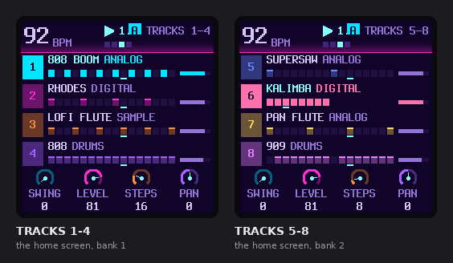
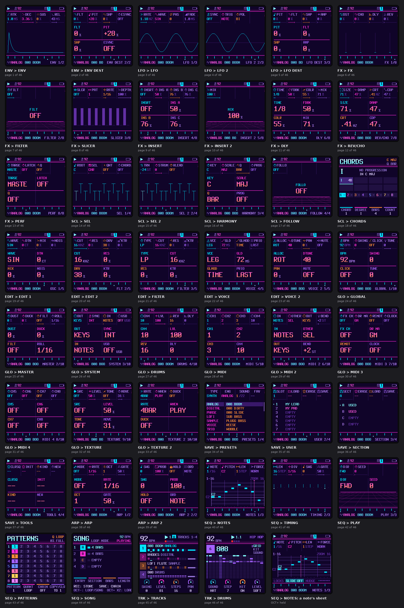
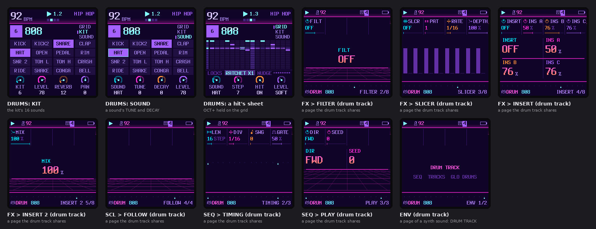
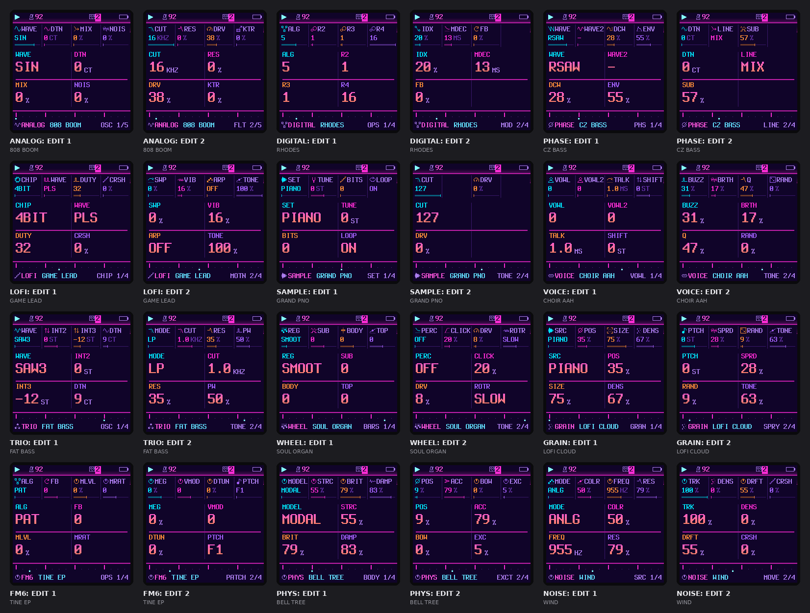
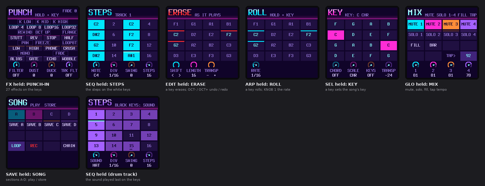
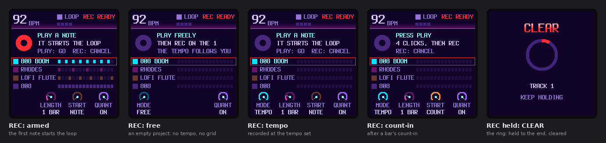
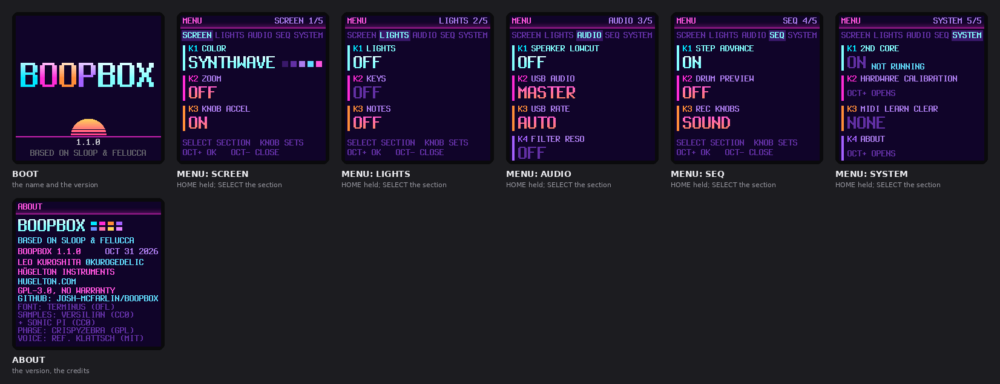
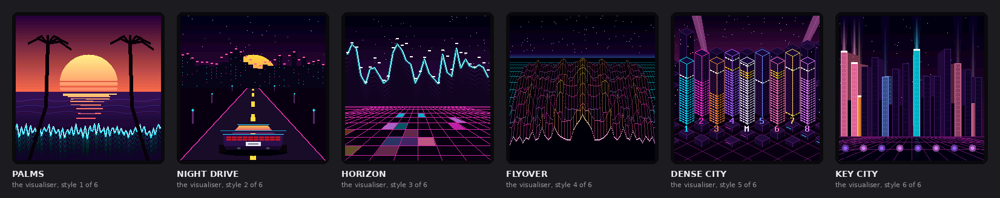

# Every screen of the firmware

Drawn by the firmware's own code on the host (`python3 tools/make_all_screens.py`), with the demo project
of `tools/screens_demo.c` on the eight tracks playing. Each screen is 240 × 240 on the FM-1, 2x here.
MENU → SCREEN → COLOR: **SYNTHWAVE** (`python3 tools/make_all_screens.py --palette 5`).

110 screens in 8 groups.

## Home (2)

The home screen (TRACKS), both banks of four

| Screen | File | |
|---|---|---|
| TRACKS 1-4 | [`home/tracks-1-4.png`](home/tracks-1-4.png) | the home screen, bank 1 |
| TRACKS 5-8 | [`home/tracks-5-8.png`](home/tracks-5-8.png) | the home screen, bank 2 |

## Pages (47)

Every page of the page table (params.c PAGES), on track 1 (ANALOG); DRUMS on the drum track

| Screen | File | |
|---|---|---|
| ENV > ENV | [`pages/env-env.png`](pages/env-env.png) | page 1 of 46 |
| ENV > ENV DEST | [`pages/env-env-dest.png`](pages/env-env-dest.png) | page 2 of 46 |
| LFO > LFO | [`pages/lfo-lfo.png`](pages/lfo-lfo.png) | page 3 of 46 |
| LFO > LFO 2 | [`pages/lfo-lfo-2.png`](pages/lfo-lfo-2.png) | page 4 of 46 |
| LFO > LFO DEST | [`pages/lfo-lfo-dest.png`](pages/lfo-lfo-dest.png) | page 5 of 46 |
| FX > FX | [`pages/fx-fx.png`](pages/fx-fx.png) | page 6 of 46 |
| FX > FILTER | [`pages/fx-filter.png`](pages/fx-filter.png) | page 7 of 46 |
| FX > SLICER | [`pages/fx-slicer.png`](pages/fx-slicer.png) | page 8 of 46 |
| FX > INSERT | [`pages/fx-insert.png`](pages/fx-insert.png) | page 9 of 46 |
| FX > INSERT 2 | [`pages/fx-insert-2.png`](pages/fx-insert-2.png) | page 10 of 46 |
| FX > DLY | [`pages/fx-dly.png`](pages/fx-dly.png) | page 11 of 46 |
| FX > REV/CHO | [`pages/fx-rev-cho.png`](pages/fx-rev-cho.png) | page 12 of 46 |
| FX > PERF | [`pages/fx-perf.png`](pages/fx-perf.png) | page 13 of 46 |
| SCL > SEL | [`pages/scl-sel.png`](pages/scl-sel.png) | page 14 of 46 |
| SCL > SEL 2 | [`pages/scl-sel-2.png`](pages/scl-sel-2.png) | page 15 of 46 |
| SCL > HARMONY | [`pages/scl-harmony.png`](pages/scl-harmony.png) | page 16 of 46 |
| SCL > FOLLOW | [`pages/scl-follow.png`](pages/scl-follow.png) | page 17 of 46 |
| SCL > CHORDS | [`pages/scl-chords.png`](pages/scl-chords.png) | page 18 of 46 |
| EDIT > EDIT 1 | [`pages/edit-edit-1.png`](pages/edit-edit-1.png) | page 19 of 46 |
| EDIT > EDIT 2 | [`pages/edit-edit-2.png`](pages/edit-edit-2.png) | page 20 of 46 |
| EDIT > FILTER | [`pages/edit-filter.png`](pages/edit-filter.png) | page 21 of 46 |
| EDIT > VOICE | [`pages/edit-voice.png`](pages/edit-voice.png) | page 22 of 46 |
| EDIT > VOICE 2 | [`pages/edit-voice-2.png`](pages/edit-voice-2.png) | page 23 of 46 |
| GLO > GLOBAL | [`pages/glo-global.png`](pages/glo-global.png) | page 24 of 46 |
| GLO > MASTER | [`pages/glo-master.png`](pages/glo-master.png) | page 25 of 46 |
| GLO > SYSTEM | [`pages/glo-system.png`](pages/glo-system.png) | page 26 of 46 |
| GLO > DRUMS | [`pages/glo-drums.png`](pages/glo-drums.png) | page 27 of 46 |
| GLO > MIDI | [`pages/glo-midi.png`](pages/glo-midi.png) | page 28 of 46 |
| GLO > MIDI 2 | [`pages/glo-midi-2.png`](pages/glo-midi-2.png) | page 29 of 46 |
| GLO > MIDI 3 | [`pages/glo-midi-3.png`](pages/glo-midi-3.png) | page 30 of 46 |
| GLO > MIDI 4 | [`pages/glo-midi-4.png`](pages/glo-midi-4.png) | page 31 of 46 |
| GLO > TEXTURE | [`pages/glo-texture.png`](pages/glo-texture.png) | page 32 of 46 |
| GLO > TEXTURE 2 | [`pages/glo-texture-2.png`](pages/glo-texture-2.png) | page 33 of 46 |
| SAVE > PRESETS | [`pages/save-presets.png`](pages/save-presets.png) | page 34 of 46 |
| SAVE > USER | [`pages/save-user.png`](pages/save-user.png) | page 35 of 46 |
| SAVE > SECTION | [`pages/save-section.png`](pages/save-section.png) | page 36 of 46 |
| SAVE > TOOLS | [`pages/save-tools.png`](pages/save-tools.png) | page 37 of 46 |
| ARP > ARP | [`pages/arp-arp.png`](pages/arp-arp.png) | page 38 of 46 |
| ARP > ARP 2 | [`pages/arp-arp-2.png`](pages/arp-arp-2.png) | page 39 of 46 |
| SEQ > NOTES | [`pages/seq-notes.png`](pages/seq-notes.png) | page 40 of 46 |
| SEQ > TIMING | [`pages/seq-timing.png`](pages/seq-timing.png) | page 41 of 46 |
| SEQ > PLAY | [`pages/seq-play.png`](pages/seq-play.png) | page 42 of 46 |
| SEQ > PATTERNS | [`pages/seq-patterns.png`](pages/seq-patterns.png) | page 43 of 46 |
| SEQ > SONG | [`pages/seq-song.png`](pages/seq-song.png) | page 44 of 46 |
| TRK > TRACKS | [`pages/trk-tracks.png`](pages/trk-tracks.png) | page 45 of 46 |
| TRK > DRUMS | [`pages/trk-drums.png`](pages/trk-drums.png) | page 46 of 46 |
| SEQ > NOTES: a note's sheet | [`pages/seq-notes-sheet.png`](pages/seq-notes-sheet.png) | OCT+ held |

## Drums (11)

The drum track: the grid's KIT and SOUND views, a hit's sheet, and the pages it shares

| Screen | File | |
|---|---|---|
| DRUMS: KIT | [`drums/drums-kit.png`](drums/drums-kit.png) | the kit's 16 sounds |
| DRUMS: SOUND | [`drums/drums-sound.png`](drums/drums-sound.png) | a sound's TUNE and DECAY |
| DRUMS: a hit's sheet | [`drums/drums-sheet.png`](drums/drums-sheet.png) | OCT+ held on the grid |
| FX > FILTER (drum track) | [`drums/drum-fx-filter.png`](drums/drum-fx-filter.png) | a page the drum track shares |
| FX > SLICER (drum track) | [`drums/drum-fx-slicer.png`](drums/drum-fx-slicer.png) | a page the drum track shares |
| FX > INSERT (drum track) | [`drums/drum-fx-insert.png`](drums/drum-fx-insert.png) | a page the drum track shares |
| FX > INSERT 2 (drum track) | [`drums/drum-fx-insert-2.png`](drums/drum-fx-insert-2.png) | a page the drum track shares |
| SCL > FOLLOW (drum track) | [`drums/drum-scl-follow.png`](drums/drum-scl-follow.png) | a page the drum track shares |
| SEQ > TIMING (drum track) | [`drums/drum-seq-timing.png`](drums/drum-seq-timing.png) | a page the drum track shares |
| SEQ > PLAY (drum track) | [`drums/drum-seq-play.png`](drums/drum-seq-play.png) | a page the drum track shares |
| ENV (drum track) | [`drums/drum-env-no-sound.png`](drums/drum-env-no-sound.png) | a page of a synth sound: DRUM TRACK |

## Engines (24)

EDIT 1 and EDIT 2 of every engine (its first factory preset, on track 2)

| Screen | File | |
|---|---|---|
| ANALOG: EDIT 1 | [`engines/engine-analog-edit1.png`](engines/engine-analog-edit1.png) | 808 BOOM |
| ANALOG: EDIT 2 | [`engines/engine-analog-edit2.png`](engines/engine-analog-edit2.png) | 808 BOOM |
| DIGITAL: EDIT 1 | [`engines/engine-digital-edit1.png`](engines/engine-digital-edit1.png) | RHODES |
| DIGITAL: EDIT 2 | [`engines/engine-digital-edit2.png`](engines/engine-digital-edit2.png) | RHODES |
| PHASE: EDIT 1 | [`engines/engine-phase-edit1.png`](engines/engine-phase-edit1.png) | CZ BASS |
| PHASE: EDIT 2 | [`engines/engine-phase-edit2.png`](engines/engine-phase-edit2.png) | CZ BASS |
| LOFI: EDIT 1 | [`engines/engine-lofi-edit1.png`](engines/engine-lofi-edit1.png) | GAME LEAD |
| LOFI: EDIT 2 | [`engines/engine-lofi-edit2.png`](engines/engine-lofi-edit2.png) | GAME LEAD |
| SAMPLE: EDIT 1 | [`engines/engine-sample-edit1.png`](engines/engine-sample-edit1.png) | GRAND PNO |
| SAMPLE: EDIT 2 | [`engines/engine-sample-edit2.png`](engines/engine-sample-edit2.png) | GRAND PNO |
| VOICE: EDIT 1 | [`engines/engine-voice-edit1.png`](engines/engine-voice-edit1.png) | CHOIR AAH |
| VOICE: EDIT 2 | [`engines/engine-voice-edit2.png`](engines/engine-voice-edit2.png) | CHOIR AAH |
| TRIO: EDIT 1 | [`engines/engine-trio-edit1.png`](engines/engine-trio-edit1.png) | FAT BASS |
| TRIO: EDIT 2 | [`engines/engine-trio-edit2.png`](engines/engine-trio-edit2.png) | FAT BASS |
| WHEEL: EDIT 1 | [`engines/engine-wheel-edit1.png`](engines/engine-wheel-edit1.png) | SOUL ORGAN |
| WHEEL: EDIT 2 | [`engines/engine-wheel-edit2.png`](engines/engine-wheel-edit2.png) | SOUL ORGAN |
| GRAIN: EDIT 1 | [`engines/engine-grain-edit1.png`](engines/engine-grain-edit1.png) | LOFI CLOUD |
| GRAIN: EDIT 2 | [`engines/engine-grain-edit2.png`](engines/engine-grain-edit2.png) | LOFI CLOUD |
| FM6: EDIT 1 | [`engines/engine-fm6-edit1.png`](engines/engine-fm6-edit1.png) | TINE EP |
| FM6: EDIT 2 | [`engines/engine-fm6-edit2.png`](engines/engine-fm6-edit2.png) | TINE EP |
| PHYS: EDIT 1 | [`engines/engine-phys-edit1.png`](engines/engine-phys-edit1.png) | BELL TREE |
| PHYS: EDIT 2 | [`engines/engine-phys-edit2.png`](engines/engine-phys-edit2.png) | BELL TREE |
| NOISE: EDIT 1 | [`engines/engine-noise-edit1.png`](engines/engine-noise-edit1.png) | WIND |
| NOISE: EDIT 2 | [`engines/engine-noise-edit2.png`](engines/engine-noise-edit2.png) | WIND |

## Layers (8)

Each function button held: the layer the keys and knobs become

| Screen | File | |
|---|---|---|
| FX held: PUNCH-IN | [`layers/layer-fx.png`](layers/layer-fx.png) | 27 effects on the keys |
| SEQ held: STEPS | [`layers/layer-seq.png`](layers/layer-seq.png) | the steps on the white keys |
| EDIT held: ERASE | [`layers/layer-edit.png`](layers/layer-edit.png) | a key erases; OCT- / OCT+ undo / redo |
| ARP held: ROLL | [`layers/layer-arp.png`](layers/layer-arp.png) | a key rolls; KNOB 1 the rate |
| SEL held: KEY | [`layers/layer-scl.png`](layers/layer-scl.png) | a key sets the song's key |
| GLO held: MIX | [`layers/layer-glo.png`](layers/layer-glo.png) | mute, solo, fill, tap tempo |
| SAVE held: SONG | [`layers/layer-save.png`](layers/layer-save.png) | sections A-D: play / store |
| SEQ held (drum track) | [`layers/layer-seq-drum.png`](layers/layer-seq-drum.png) | the sound played last on the keys |

## Rec (5)

REC: armed, the free take's screens, the clear ring

| Screen | File | |
|---|---|---|
| REC: armed | [`rec/rec-armed.png`](rec/rec-armed.png) | the first note starts the loop |
| REC: free | [`rec/rec-free.png`](rec/rec-free.png) | an empty project: no tempo, no grid |
| REC: tempo | [`rec/rec-tempo.png`](rec/rec-tempo.png) | recorded at the tempo set |
| REC: count-in | [`rec/rec-count-in.png`](rec/rec-count-in.png) | after a bar's count-in |
| REC held: CLEAR | [`rec/rec-hold-clear.png`](rec/rec-hold-clear.png) | the ring: held to the end, cleared |

## System (7)

The boot screen, the menu's five sections (HOME held) and ABOUT

| Screen | File | |
|---|---|---|
| BOOT | [`system/boot.png`](system/boot.png) | the name and the version |
| MENU: SCREEN | [`system/menu-screen.png`](system/menu-screen.png) | HOME held; SELECT the section |
| MENU: LIGHTS | [`system/menu-lights.png`](system/menu-lights.png) | HOME held; SELECT the section |
| MENU: AUDIO | [`system/menu-audio.png`](system/menu-audio.png) | HOME held; SELECT the section |
| MENU: SEQ | [`system/menu-seq.png`](system/menu-seq.png) | HOME held; SELECT the section |
| MENU: SYSTEM | [`system/menu-system.png`](system/menu-system.png) | HOME held; SELECT the section |
| ABOUT | [`system/menu-about.png`](system/menu-about.png) | the version, the credits |

## Visualiser (6)

The visualiser's six styles (tap HOME on TRACKS)

| Screen | File | |
|---|---|---|
| PALMS | [`visualiser/vis-palms.png`](visualiser/vis-palms.png) | the visualiser, style 1 of 6 |
| NIGHT DRIVE | [`visualiser/vis-night-drive.png`](visualiser/vis-night-drive.png) | the visualiser, style 2 of 6 |
| HORIZON | [`visualiser/vis-horizon.png`](visualiser/vis-horizon.png) | the visualiser, style 3 of 6 |
| FLYOVER | [`visualiser/vis-flyover.png`](visualiser/vis-flyover.png) | the visualiser, style 4 of 6 |
| DENSE CITY | [`visualiser/vis-dense-city.png`](visualiser/vis-dense-city.png) | the visualiser, style 5 of 6 |
| KEY CITY | [`visualiser/vis-key-city.png`](visualiser/vis-key-city.png) | the visualiser, style 6 of 6 |
