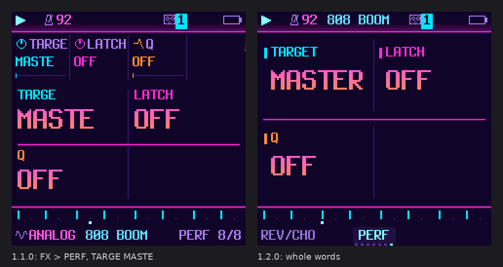
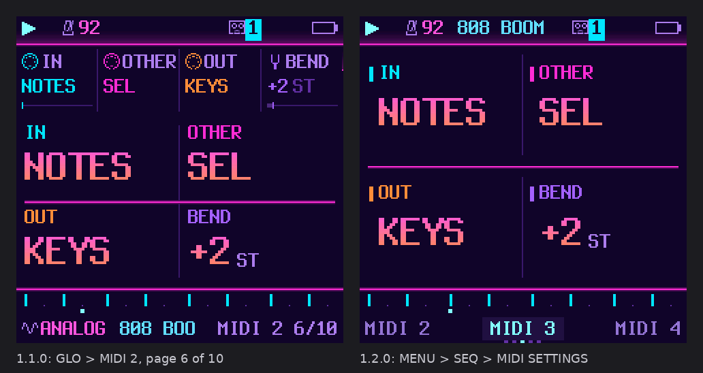

# BoopBox UX review: the screen, the knobs and the buttons

A review of BoopBox on the FM-1: what felt cluttered or hard to find, what to change, and what to keep. It looks at
every screen as the firmware draws it (`assets/screens/all/`, `tools/make_all_screens.py`), the firmware's code and the
hardware.

**BoopBox 1.2.0 builds most of it.** Every picture here is the firmware's own drawing in SYNTHWAVE: 1.1.0 on the
left, 1.2.0 on the right. **[Every screen, before and after](before-after-all.png)** is one large image of all 111.

## What 1.2.0 changed

| # | Change | In 1.2.0 |
|---|---|---|
| 1 | **One page template:** four values in the knobs' corners, shown once; the family's pages as tabs; the sound in the header | **built** |
| 2 | **Device settings out of GLO:** MIDI, MIDI 2–4 and SYSTEM in their own pages, opened from the menu | **built** (MENU → SEQ → MIDI SETTINGS) |
| 3 | **Fewer pages per button,** no setting on two pages | **built** for GLO (10 → 5) and FX (8 → 7); no setting on two pages |
| 4 | **ALGORITHM picks the track on every screen,** and says which | **built** (the header names it) |
| 5 | **Fixed knob roles** (KNOB 1 the choice, KNOB 4 the amount) | not changed: see below |
| 6 | **Name what OCT− and OCT+ do** where they are not octave | **built** for the step's sheet on NOTES |
| 7 | **One way to confirm** a destructive action | changed: the knob prompts say *TURN AGAIN* |
| 8 | **The step sheet in tabs,** white keys as a component palette | not changed: see below |
| 9 | **GLO held shows faders** | **built** |
| 10 | **A help overlay** | not built: the flash |
| — | Whole words: labels and values no longer cut at five letters (*TARGE MASTE* → *TARGET MASTER*) | **built** |
| — | The ENV curve drawn in its knobs' colours | **built** |

1.2.0 is 1,992 B larger than 1.1.0; 1,812 B of the app slot are left (`docs/groovebox-performance.md`).

### Value pages: every value once, in its knob's corner

On the 29 pages without a graph, 1.1.0 drew the four values twice: small in columns along the top, and large in a
2 × 2 grid below. 1.2.0 draws them once, large, from just under the header. KNOB 1 is top left, 2 top right, 3
bottom left, 4 bottom right. Each label is in its knob's
colour with a short bar beside it. The footer no longer repeats the engine and the sound, which now sit in the
header, once.

### Page tabs

The footer's second row shows the page's name between the page before and the page after it: what SELECT, or the
button tapped again, brings. A dot a page under it marks the place in the family. This replaces *OSC 1/5* and the
cut-off engine and preset names (*ANALOG 808 BO*).

### Whole words

`fit()` cut every label and every named value to five letters, whatever the room: *TARGE*, *MASTE*, *FOLLO*,
*DR MA*. The large values now keep up to eight letters, and are cut only by the space they really have.

### The ENV curve in its knobs' colours

Attack is drawn in KNOB 1's colour, decay in KNOB 2's, sustain in 3's and release in 4's. The graph then
labels itself.

### ALGORITHM on every page

1.1.0 changed the track with ALGORITHM only on TRACKS, PATTERNS and CHORDS; elsewhere a turn did nothing. Going from
track 1's envelope to track 3's meant HOME, ALGORITHM, ENV. In 1.2.0 ALGORITHM changes the track on any page, the
page stays, and the header says *TRACK 3: LOFI FLUTE* for a moment. A stray turn is plain to see, and one detent
back undoes it. During a free take it still does nothing.

### The MIDI setup out of GLO

GLO had ten pages. It mixed what you change while making music (tempo, swing, the master filter, the drums' mix,
the texture) with setup you do once. The setup was MIDI channels, IN and OUT, the clock, and the punch-in FX
channel. Some settings were on two pages: MIDI IN and OUT on SYSTEM and MIDI 2, and the drums' channel on DRUMS and
MIDI.

In 1.2.0, GLO has five pages: GLOBAL, MASTER, DRUMS, TEXTURE and TEXTURE 2. The setup has its own five pages,
opened from **MENU → SEQ → MIDI SETTINGS** (hold HOME, SELECT to SEQ, OCT+):

| Page | Settings |
|---|---|
| MIDI | CH1, CH2, CH3, CH4 (the drums) |
| MIDI 2 | CH5–CH8 |
| MIDI 3 | IN, OTHER, OUT, BEND |
| MIDI 4 | FX CH, DR MAP, REMOTE, CLOCK |
| SYSTEM | SYNC, USB |

SELECT walks them and GLO's light stays on. Every global setting is now on one page only, and a test checks it.

### FX: INSERT 2 folded into FILTER

INSERT 2 was a page holding one value, the insert's dry/wet. It now sits beside the track filter on FX → FILTER, so
FX has seven pages.

### GLO held: a mixer you can read

The GLO layer showed mute, solo, fill, bar and tap as a 4 × 4 grid of tiles. It now shows the bank's four levels as
faders (muted ones dim), with mute and solo under each, and FILL, BAR and the tap tempo below. The keys are the same
as before: 1–4 mute, 5–8 solo, 9 fill, 10 fill on the next bar, 16 tap. The knobs still set the levels.

### What OCT− and OCT+ do in the step's sheet

The sheet on NOTES (OCT+ held) and its LOCKS and COMP strips use OCT+ for an action and OCT− to go back, and nothing
said so. While the sheet is open, the footer's second row now says what each does: *OCT− CLOSE · OCT+ SLIDE*,
*OCT+ COPY*, *OCT+ OPEN*, and in the strips *OCT− BACK · OCT+ ADD* or *REMOVE*. These are soft-key labels, on the two
buttons BoopBox uses as soft keys.

### Knob confirmations

The settings that act on a second detent (CLRSQ, NEW, KIND, ERASE on SECTION, the user presets' GO, CLEAR and COPY
on PATTERNS) now say *TURN AGAIN: …*, not *AGAIN: …*. A knob cannot be held, so these keep the two-detent gesture; the
prompt now says which gesture.

## What 1.2.0 left as it was, and why

- **Fixed knob roles (5).** An audit found most pages already put the main value on KNOB 1. Moving the others' slots
  would retrain the hands of everyone who knows them, for little gain. Pages that break the rule now say so with
  whole labels.
- **The step sheet in tabs and the white-key component palette (8).** This changes what the keys do on the NOTES
  page, where they enter notes. The OCT strip (6) fixes the worst of it, telling you what OCT+ opens. The palette is
  the next idea to try.
- **Hold-to-confirm everywhere (7).** The *AGAIN* confirmations are made with knobs, and a knob cannot be held; REC's
  hold ring stays where a button does it.
- **A help overlay (10).** Its text would need about a kilobyte that 1.2.0 does not have to spare.
- **The dials at the top of the full screens.** TRACKS, PATTERNS, CHORDS, SONG, DRUMS and REC keep their knob dials
  at the bottom. Moving them means redrawing six screens, for a small gain, and they are consistent with each other.
- **Blue means two things.** KNOB 1 and track 1 still share a colour. The header's track chip helps, and fixed knob
  colours that no track uses would change every screen, so that is your call.

## What already worked, and stays

- **Layers.** Hold a button, and the keys and knobs change job while the screen shows how. The held button is the
  context, on hardware without a shift button.
- **Undo and redo** (EDIT + OCT− / OCT+).
- **Hold REC until the ring fills** to clear a track.
- **Autosave,** and power-on as you left it.
- **The drum track's single-sound view** in the SEQ layer.
- **Light as feedback:** the PLAY light on the beat, keys lit while playing, red for recording.
- **Recording with no click,** and free-tempo takes.

## The findings that led here

These are the original findings, checked again on 1.1.0's screens as rebuilt from main before this change
(SYNTHWAVE by default, SEQ's PATTERN page renamed TIMING).

- **Every value twice** on 29 of 46 pages, and **five bands on 240 pixels**: status bar, columns, values, step
  marks, and a footer repeating the header's track and cutting names to fit.
- **Labels cut to five letters** by `fit()`, not abbreviated on purpose.
- **Knob slots that move:** at the top of the parameter pages, at the bottom of the full screens. The FM-1's knobs sit
  level with the top of the screen.
- **46 pages behind 10 buttons,** GLO with ten and FX with eight, settings on two pages, and the place in a family
  shown only as *MIDI 3 7/10*.
- **ALGORITHM on three screens only.**
- **Controls whose job changes by screen** (SELECT, SAVE, HOME, OCT+) with nothing on screen saying what they do
  now. The screen should name each button's current job.
- **Gestures nobody would find:** adding a step component is cursor, hold OCT+, KNOB 1 to the last row, tap OCT+.
- **The panel's labels:** the black keys are printed OP1–OP6, PIT, GLO, MONO and POLY, and one encoder ALGORITHM,
  which are the stock firmware's meanings. The screen has to be the label.

## Design principles that fit the FM-1

- **One screen per module, four values, each in its knob's colour.**
- **Any parameter within two presses,** and its button's pages named on screen.
- **Graphics first,** with each part of a graph in its knob's colour.
- **Press the same button again** for the next page or to toggle.
- **Hold a button as the modifier,** since the FM-1 has no spare buttons.
- **Soft-key labels** on the screen for what the buttons do now.
- **Settings in columns:** one knob for the section, one for the item, one for the value. BoopBox's
  menu already works this way.
- **Non-destructive removes, one strong confirmation** for real deletes.

## Next

1. The white-key component palette on the step's sheet (8).
2. OCT strip hints on the drum grid's sheet and on PATTERNS (6).
3. Help on the device (10), when there is flash for it.

The screenshots for any change come from `python3 tools/make_all_screens.py`. The pictures here come from
`tools/ux-mockups/mock.py` and `tools/make_before_after.py`, given the gallery as it was before the change.
