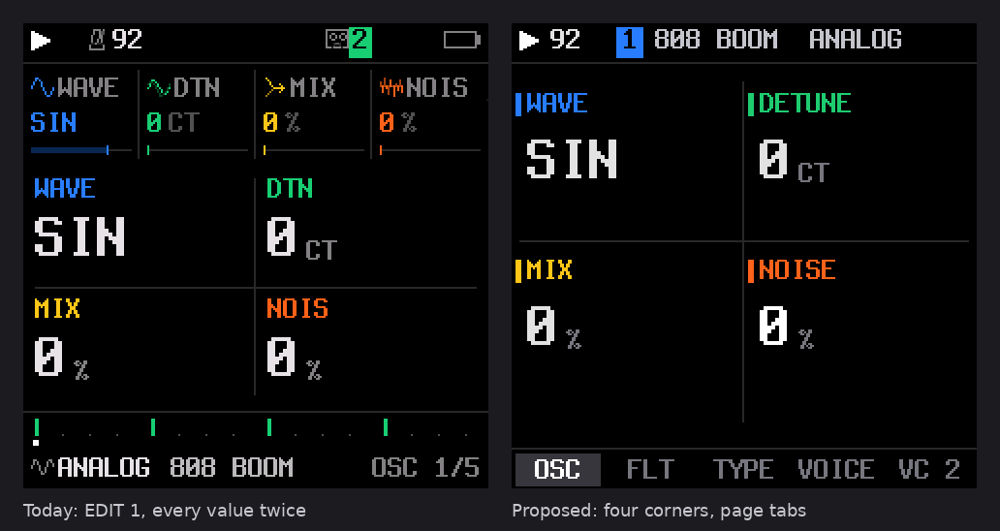
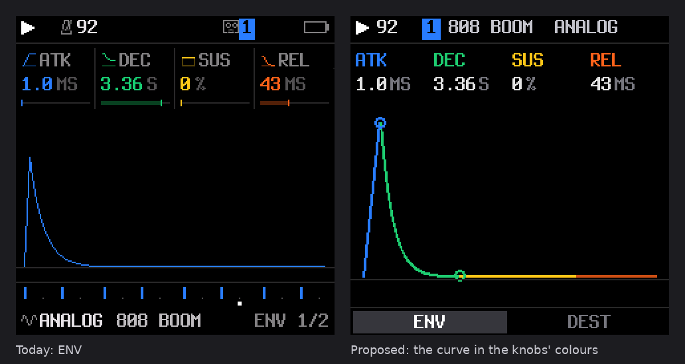
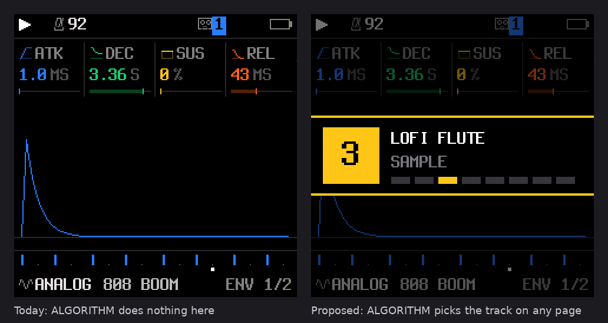
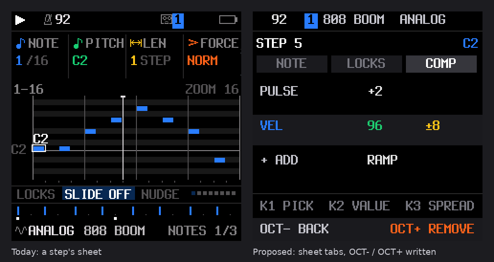
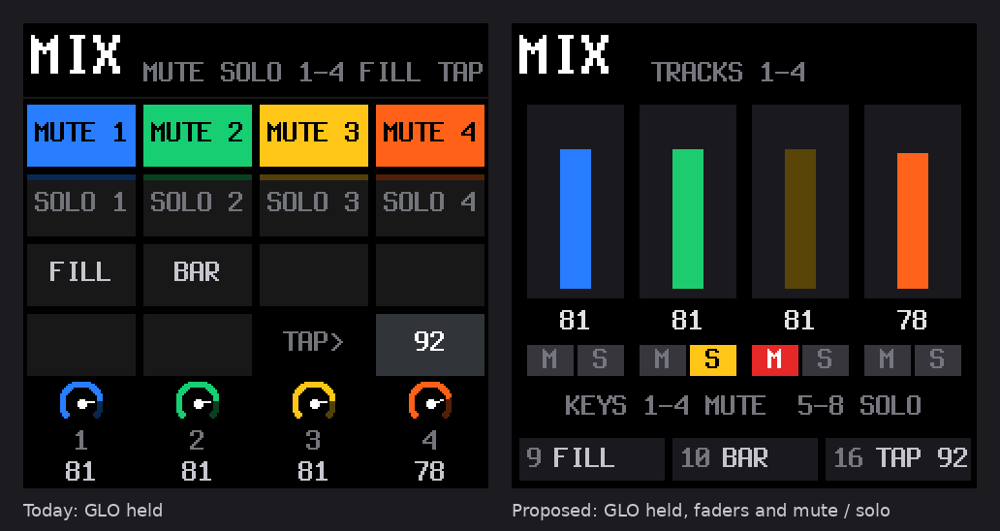

# BoopBox UX review: the screen, the knobs and the buttons

A review of BoopBox 1.1.0 on the FM-1: what feels cluttered or hard to find, what to change, and what to keep. It
uses all 110 screens as the firmware draws them (`assets/screens/all/`), the firmware's code, the hardware photo, and
Teenage Engineering's OP-1 field user guide and OP-XY full guide 1.0.9. The mockups are drawn at 240 × 240 in the
firmware's own font and colours (`tools/ux-mockups/mock.py`). Today's screen is on the left, the proposal on the right.

Page numbers such as *OP-1 p.11* or *OP-XY p.26* are PDF pages of those guides.

## Summary

The FM-1 has more controls than most grooveboxes its size: four parameter knobs, four utility encoders, twelve
function buttons, two octave buttons and 27 keys. BoopBox already uses them well where you **play**: the layers
(hold a button, and the keys and knobs change job) are close to how the OP-XY works. Where you **edit**, it is less
tidy:

- **The screen says things twice.** On most pages each value appears in a small column at the top and again in large
  type below. The engine and preset shown in the footer are already known from the header.
- **46 pages sit behind 10 buttons.** GLO has 10 pages and FX has 8. Several settings appear on two pages, and you
  can only tell where you are from a number like *MIDI 3 7/10*.
- **The same control does different things on different screens.** SELECT, SAVE, HOME and OCT+ each change job by
  screen. Some actions need gestures no screen mentions: a step component takes four.

TE's devices follow a few rules that fit the FM-1's hardware:

- one screen per module, four values on it, each in the colour of its knob
- any parameter within two presses
- pressing the same button again for the next page
- holding a button as the modifier, since neither device has spare buttons
- the screen labels what the buttons do right now

### The ten changes, in order

| # | Change | Effort |
|---|---|---|
| 1 | **One page template:** four values in the knobs' corners, shown once. Name the family's pages in tabs at the bottom. Drop the footer. | medium |
| 2 | **Move the device settings out of GLO** into the HOME-held menu: MIDI, MIDI 2–4, SYSTEM, the drums' MIDI channel. GLO keeps GLOBAL, MASTER and TEXTURE. | small |
| 3 | **At most four pages per button.** Split or merge FX, SCL, EDIT and SEQ so each has four pages or fewer, with no setting on two pages. | medium |
| 4 | **ALGORITHM picks the track on every screen,** with a one-second band naming it. | small |
| 5 | **Fixed knob roles:** KNOB 1 picks or is the main value, KNOB 4 is amount, mix or level. Every list uses KNOB 1 for the group and KNOB 2 for the item. | small (audit) |
| 6 | **Name what OCT− and OCT+ do on any screen where they are not octave:** BACK, ADD, REMOVE, AGAIN. | small |
| 7 | **One way to confirm a destructive action:** hold until a ring fills, as REC already does, instead of turning a knob twice for *AGAIN*. | small |
| 8 | **The step sheet in tabs** (NOTE · LOCKS · COMP), each reached in one press. In COMP, the white keys pick a component type. | medium |
| 9 | **GLO held shows faders:** the bank's four levels, with mute and solo marked. | small |
| 10 | **A help overlay:** hold OCT− and OCT+ together to see what every knob and button does on the current screen. | medium |

The firmware has 3,908 B of flash free. Changes 1, 2, 3 and 6 mostly remove or move drawing code, so they should cost
little or free space. Changes 8 and 10 are the only ones that need room.

## What already works: keep it

- **Layers.** Hold FX, SEQ, EDIT, ARP, SEL, GLO or SAVE, and the keys and knobs change job while the screen shows how.
  This is the OP-XY's "the held button is the context, the second press is the action" (*OP-XY p.13*) on hardware
  without a shift button. Locking a layer (hold it, tap HOME) is a good addition.
- **Undo and redo** (EDIT + OCT− / OCT+). Neither TE guide describes an undo; the OP-XY keeps saved versions instead
  (*OP-XY pp.37–38*).
- **Clearing a track by holding REC until a ring fills.** This is the OP-XY's hold-to-confirm (*OP-XY p.26*). Change 7
  makes it the only confirmation.
- **Autosave and power-on as you left it,** as on the OP-1 (*OP-1 p.5*).
- **The drum track's single-sound view:** SEQ held shows the steps of the sound you played last, as the OP-XY does
  (*OP-XY p.26*).
- **Light as feedback:** the PLAY button flashes on the beat, keys light while playing, keys 1, 5, 9 and 13 glow while
  a layer is held, and red means recording.
- **Recording with no click,** and free-tempo takes. TE has nothing simpler.

## What gets in the way

### The screen

**Every value twice.** A page without a graph draws the four values in columns across the top (icon, label, value, a
gauge) and the same four again large in a 2 × 2 grid below (`ui_draw.c graph_big`). That is 29 of the 46 pages. The
top columns could be dropped on those pages.

**Five bands on 240 pixels.** A parameter page stacks the status bar, the four columns, the graph or big values, a row
of page dots, and a footer with the engine, the preset and the page title. The footer repeats the header's track and
cuts names to fit: *808 BOO*, *ANALOG 808 BO*, *TEXTURE 2 10/10*.

**Labels cut to five letters.** *TARGE MASTE* (FX → PERF), *FOLLO*, *DR MA*, *REMOT*, *CLRSQ*, *INSRT*, *DTUNE*. A
label is cut wherever the column runs out (`fit()`), not abbreviated on purpose. TE uses short words chosen once,
such as *dest*, *amt*, *rng*.

**Knob slots move around.** On parameter pages the four knobs' values are at the top of the screen. On TRACKS,
PATTERNS, CHORDS, SONG, DRUMS and the REC screen they are dials at the bottom. On the FM-1 the four knobs sit in a row
level with the top of the screen, so the top is the natural place, and it should be the same everywhere. The OP-1
puts its effect values in fixed corners on every screen (*OP-1 pp.20–23*). The OP-XY puts its four panels under
its four knobs (*OP-XY pp.48–51*).

**Blue means two things.** Blue is KNOB 1 and also track 1; green is KNOB 2 and track 2. On track 3 the knob labels
are still blue, green, yellow and orange while the track's own colour is yellow. TE keeps these apart: the OP-XY's
knobs are four greys and its track lights are white or red (*OP-XY p.5*). Change 1 keeps the colours for the knobs
and shows the track by its number chip in the header. A firmer fix, and a matter of taste, is to draw the four knob
slots in fixed colours that no track uses.

**Graphs are drawn in one colour.** The ENV curve is the track's colour, and its four values sit above it, separate.
On the OP-1 each part of a graph is drawn in its knob's colour: attack blue, decay ochre (*OP-1 p.19*). The graph
then labels itself, so the values can be smaller.

### Pages and buttons

**Too many pages per button.** In order of the buttons:

| Button | Pages |
|---|---|
| ENV | ENV · ENV DEST |
| LFO | LFO · LFO 2 · LFO DEST |
| FX | FX · FILTER · SLICER · INSERT · INSERT 2 · DLY · REV/CHO · PERF (**8**) |
| SEL | SEL · SEL 2 · HARMONY · FOLLOW · CHORDS |
| EDIT | EDIT 1 · EDIT 2 · FILTER (ANALOG only) · VOICE · VOICE 2 |
| GLO | GLOBAL · MASTER · SYSTEM · DRUMS · MIDI · MIDI 2 · MIDI 3 · MIDI 4 · TEXTURE · TEXTURE 2 (**10**) |
| SAVE | PRESETS · USER · SECTION · TOOLS |
| ARP | ARP · ARP 2 |
| SEQ | NOTES · PATTERN · PLAY · PATTERNS · SONG |

Reaching MIDI 3 takes seven taps of GLO, or SELECT turned six detents. Two families hold a FILTER page (FX's track
filter and EDIT's ANALOG filter). GLO mixes things you change while playing (tempo, master filter, dust) with device
setup you set once (MIDI channels, clock, routing). Some settings are on two pages: MIDI IN and OUT on both SYSTEM and
MIDI 2, the drums' channel on both DRUMS and MIDI. SEQ mixes four kinds of thing: the note editor, the pattern's
settings, the pattern bank, and the song.

On the OP-XY each mode has exactly four modules on four buttons, in the same order on every track type: source,
envelope, filter, LFO (*OP-XY pp.44–47*). On the OP-1, four keys (T1–T4) reach every module in one press
(*OP-1 p.7*).

**ALGORITHM picks the track on three screens only.** It works on TRACKS, PATTERNS and CHORDS, and a turn anywhere
else does nothing (`ui_input.c`, to avoid stray track changes). Moving from track 1's envelope to track 3's means
HOME, ALGORITHM, ENV. The OP-XY's track buttons work in every mode (*OP-XY p.23*). The stray-turn worry is better met
with a clear band naming the new track, which also makes a mistake obvious and quick to undo.

**Controls that change job by screen:**

| Control | Its jobs today |
|---|---|
| SELECT | tempo (TRACKS, layers) · previous / next page (pages) · grid / kit (DRUMS) · section (menu) · style (visualiser) |
| SAVE | the SONG screen (on TRACKS) · the SAVE pages (elsewhere) · the song layer (held) |
| HOME | TRACKS · the visualiser (on TRACKS) · the menu (held) · lock a layer (tapped while one is held) |
| OCT+ | octave · hard hits (drums, held) · open the sheet (held 0.4 s) · next page of the drum grid (tapped) · add, remove or open (sheet, menu) · *AGAIN* |

Some reuse is unavoidable with this few buttons, and TE reuses too: the OP-1's encoder tap means confirm, reset or
zoom by screen (*OP-1 p.8*). The difference is that TE puts the button's current job on the screen: soft-key labels
above M1–M4 (*OP-XY pp.37–38*) and coloured pills for T1–T4 (*OP-1 p.54*). BoopBox's octave buttons do the most and
are labelled the least.

**Gestures nobody would find.** Adding a step component means: put the cursor on the step, hold OCT+ for 0.4 s, turn
KNOB 1 to the last row (*COMP*), then tap OCT+ (`docs/groovebox-controls.md`). On the OP-XY you hold shift, tap the
steps, and press a white key, which has the component's icon printed on it (*OP-XY pp.31–33*).

**Two ways to confirm.** Clearing a track is a hold with a filling ring. Clearing a sequence, NEW PROJECT, changing a
track's KIND, erasing a section, and CLEAR or COPY on PATTERNS are a knob turned once (*AGAIN: …*) and then again.
The second gesture is easy to complete by accident while turning, and it is not the first one users learn.

**The panel's labels.** The black keys are printed OP1–OP6, PIT, GLO, MONO and POLY, and one encoder is printed
ALGORITHM. These are the stock firmware's meanings, and BoopBox uses none of them. The firmware cannot change the
print, but it can make the screen the label wherever the black keys do something other than play notes (the FX
layer's eleven effects). A printable overlay in the README would also help.

**The docs have drifted.** The README's controls table still says ALGORITHM picks *1 · 2 · 3 (synths) · 4 (drums)*,
and its menu section lists four sections where the firmware has five.

## The proposals

### 1. One page template

Every page uses the same template, top to bottom:

- **Status bar:** transport, BPM, and the track as its number chip plus its sound, for example *[1] 808 BOOM
  ANALOG*. Nothing else on screen repeats this.
- **Body, one of two kinds:**
  - **Value pages:** the four values in the corners of their knobs (KNOB 1 top left, 2 top right, 3 bottom left,
    4 bottom right). Each has a short label in its knob's colour and the value large, white while it is turned. They
    are not repeated in small columns. This is the OP-1's effect layout (*OP-1 pp.20–23*).
  - **Graph pages** (ENV, LFO, FX, SEL, SLICER, NOTES): one row of the four values at the top, under the knobs, and
    the graph filling the rest. Every part of the graph is drawn in the colour of the knob that moves it
    (*OP-1 pp.15, 19*).
- **Tabs:** the family's pages by name along the bottom, the one shown lit. This replaces the footer, *ENV 1/2* and
  the page dots. It tells you where you are, what else is behind the button, and how many taps it takes.

Labels get a fixed short form chosen once (*DEST*, *AMT*, *RATE*, *TGT*), never cut mid-word, and a table of them
lives with the page table. Pages that run out of room show fewer things, not shorter words.

Big screens of their own (TRACKS, PATTERNS, CHORDS, SONG, DRUMS, REC) move their four knob dials to the top. This
matches the hardware and the parameter pages.

### 2. Settings where settings live

The HOME-held menu already works like the OP-XY's settings page: SELECT picks the section and KNOB 1–3 the rows
(*OP-XY p.23*). Add a **MIDI** section to it (the eight channels, IN, OTHER, OUT, BEND, FX CH, DRUM MAP, REMOTE,
CLOCK OUT) and move SYSTEM's clock and sync settings into it. GLO then holds what you change while making music:
GLOBAL (BPM, swing, click, tune), MASTER and TEXTURE. This makes GLO three pages instead of ten, and puts each
setting on one page only.

One open question: today the MIDI channels are saved with the project (`song.g`). Moving them to the menu could keep
them per project, or make them device settings as the OP-XY does. Device settings are simpler for most users, who
set their MIDI once.

### 3. Four pages per button, at most

A possible regrouping, each family's pages in the order used most:

| Button | Pages |
|---|---|
| ENV | ENV · DEST (ENV SYNC moves onto DEST's spare slot) |
| LFO | LFO · LFO 2 · DEST |
| FX | SENDS (dist, chorus, delay, reverb) · INSERT (type and A–C, MIX as INSERT's 4th knob via a hold) · SLICER · FILTER |
| FX, held | as now: punch-in; its PERF settings (target, latch, quantise) move to the layer's knobs |
| SEL | KEY (root, scale, quantise, chord) · VOICING (transpose, strum, voice-lead) · CHORDS (progression; HARMONY's key and scale as its header, FOLLOW per track already on it) |
| EDIT | ENGINE 1 · ENGINE 2 · VOICE · VOICE 2 (ANALOG's filter type takes a spare slot on ENGINE 2) |
| GLO | GLOBAL · MASTER · TEXTURE (both TEXTURE pages, five knobs, over two tabs or a hold) |
| SAVE | USER · SECTION · TOOLS (PRESETS is the sound browser now) |
| ARP | ARP · ARP 2 |
| SEQ | NOTES · PATTERN (length, division, swing, gate, direction, seed) · PATTERNS; SONG stays on SAVE, tapped on TRACKS |

The delay and reverb settings (DLY, REV/CHO) are global, so they would move from FX to GLO → MASTER or a fourth GLO
tab. The rule matters more than this exact layout: four pages at most, one place per setting, and the same order
every time.

### 4. ALGORITHM on every screen

Turning ALGORITHM changes the track on whatever page is shown, and the page follows the new track. A band names the
track for a second (its number large in its colour, its sound and engine, eight small blocks with the new track lit)
over the dimmed page, as in the mockup. The band also makes a stray turn obvious, and one detent back undoes it.
During a free take it stays locked, as now. The OP-1 changes context with one press and no menu (*OP-1 p.6*); the
OP-XY's track buttons work in every mode (*OP-XY p.23*).

### 5. Fixed knob roles

The OP-XY's knob 1 is always the main "what" (speed, cutoff, attack, tempo), and knob 4 is always the "how much"
(release, mix, hold, level). Its high-pass is always left of its low-pass (*OP-XY pp.30–65*). The OP-1 uses blue to
choose in every list (*OP-1 pp.9–50*). For BoopBox:

- **KNOB 1:** the main value or the choice (type, wave, rate, the list's group).
- **KNOB 4:** amount, mix, depth or level. This is already true on ENV (release), DLY (mix) and FX (the reverb
  send). It is not true on INSERT, whose mix is KNOB 1 of a second page, or on TEXTURE, whose level is KNOB 2.
- **Lists** (sound browser, presets, sections, menu): KNOB 1 is the group, KNOB 2 the item, KNOB 3 the value.
  PRESETS keeps scrolling the sound browser.
- **Pages that cannot follow the rule** say so with their labels; the rule is a default, not a law.

This is an audit of the page table (`params.c PAGES`), a few slot swaps and no new code.

### 6. Name what OCT− and OCT+ do

Where OCT− or OCT+ is not octave, a one-line strip at the bottom names it, for example *OCT− BACK* and *OCT+ REMOVE*
in the step sheet, *OCT+ ADD* in the component strip, *OCT+ AGAIN: CLEAR* on PATTERNS. These are the OP-XY's soft
keys (*OP-XY pp.37–38*) on the two buttons BoopBox uses as soft keys. It costs a line of text per screen and fixes
most of the gestures nobody can find.

### 7. One confirmation

Every destructive action works like REC's clear: hold the button that does it until a ring fills (about a second),
and let go early to cancel. This covers clearing a sequence, NEW PROJECT, changing a track's KIND, erasing a section,
CLEAR and COPY on PATTERNS, and erasing a user preset. Removing something that can come back (a component, an entry
from the song) needs no confirmation, as on the OP-XY (*OP-XY p.4*). The *AGAIN* knob gesture goes.

### 8. The step sheet in tabs

On the NOTES page and the DRUMS grid, holding OCT+ still opens the step's sheet. It now has three tabs, NOTE, LOCKS
and COMP, and tapping OCT+ steps through them. In COMP, KNOB 1 picks a component (or *+ ADD*), KNOB 2 sets its value
and KNOB 3 its spread. The strip at the bottom says what OCT− and OCT+ do.

The OP-XY's best idea goes further: while COMP is open, the white keys choose the component type (PULSE, HOLD, MULT,
VEL, RAMP and so on, one per key, named on screen) and the black keys set its amount (*OP-XY pp.31–33*). It turns a
list into a palette under your fingers.

### 9. GLO held: a mixer you can read

Today the GLO layer shows mute, solo, fill, bar and tap as a 4 × 4 grid of tiles, with the levels as four small dials
at the bottom. The proposal shows the bank's four levels as faders (the OP-XY's mixer overview, *OP-XY p.5*), with
mute and solo marked under each and the keys that do them written once. FILL, BAR and tap tempo stay, as a row of
three. Muted tracks draw their fader dim.

This gives up the grid's one-tile-per-key picture. Keys 1, 5, 9 and 13 glow to mark the grid's rows, and that
mapping would need a new form, such as lit mute and solo keys.

### 10. Help on the device

Hold OCT− and OCT+ together for about half a second. (Tapping both still resets the octave.) An overlay then lists
what the four knobs, SELECT, PRESETS, ALGORITHM, OCT− and OCT+ do on this screen, and which buttons can be held for a
layer. Let go to close it. The OP-1 has this on a dedicated help key: hold it for the screen, or press help plus a key
to learn that key (*OP-1 p.7*). Most of the text already exists as the pages' labels and the layers' sub lines, so
the overlay would mostly reuse it. It still needs flash for its strings, so do it last and measure.

## Smaller ideas worth taking

- **Press the button again to toggle a module** (OP-1 FX and LFO, *OP-1 pp.20, 25*). For example, on the LFO page a
  second tap at the last page could switch the LFO off. Cycling pages is BoopBox's existing meaning, so only where
  a family has a natural on/off.
- **Named steps instead of numbers** (*OP-XY p.40*: delay size *micro … insane*). BoopBox already names the delay's
  note values and the ARP rates. Swing, dust and duck could show a word next to the number.
- **A sound path screen** that flags anything silencing a track (a mute, a level at 0, MUTE ON in VOICE 2, a FOLLOW
  that leaves no notes) answers "why is there no sound?" in one screen (*OP-1 p.42*).
- **Copy the sound with the pattern** on PATTERNS (*OP-XY p.3*), or at least offer it.
- **A printable panel overlay** for the black keys and the ALGORITHM encoder, linked from the README.

## Order of work

1. **Docs** (now): fix the README's controls table and the menu's sections.
2. **No-risk wins:**
   - ALGORITHM everywhere (4)
   - the OCT strip (6)
   - one confirmation (7)
   - the knob audit (5)
3. **The template** (1), page by page: it changes every screenshot, and `tools/make_all_screens.py` makes the review
   easy.
4. **The regrouping** (2, 3). The page you were on is not saved with a project or the settings (`ui.fam_last`
   lives in RAM only), so regrouping changes no saved format. Moving the MIDI settings out of the project would.
5. **The step sheet and the mixer layer** (8, 9).
6. **Help** (10), if the flash allows.

Each step can ship alone. The screenshots for any branch come from `python3 tools/make_all_screens.py` (MONO) and
`--palette 5` (SYNTHWAVE).

## Questions for you

1. Should MIDI channels become device settings in the menu, or stay with each project?
2. The step sheet's white-key palette (8) changes what the keys do while the sheet is open. Is that acceptable on
   the NOTES page, where the keys enter notes?
3. Should the GLO mixer (9) replace the 4 × 4 grid, or be a second view you switch to?
4. Fixed knob colours that no track uses (a firmer fix for "blue means two things") would change the look of every
   screen. Worth trying, or is the header chip enough?
