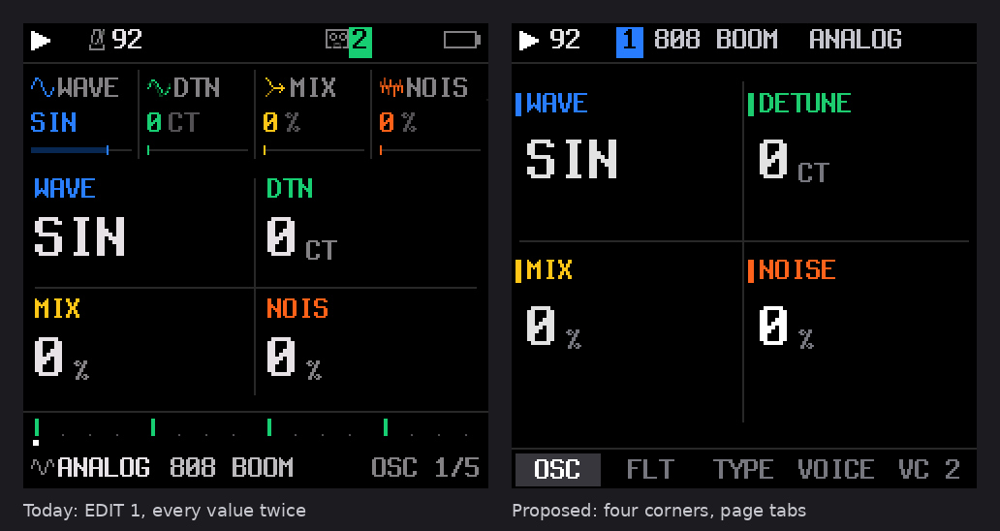
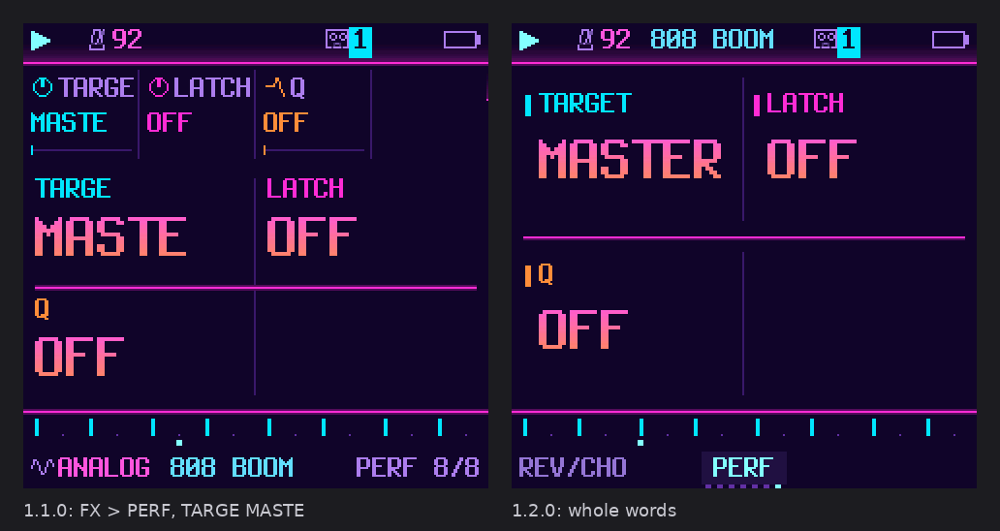
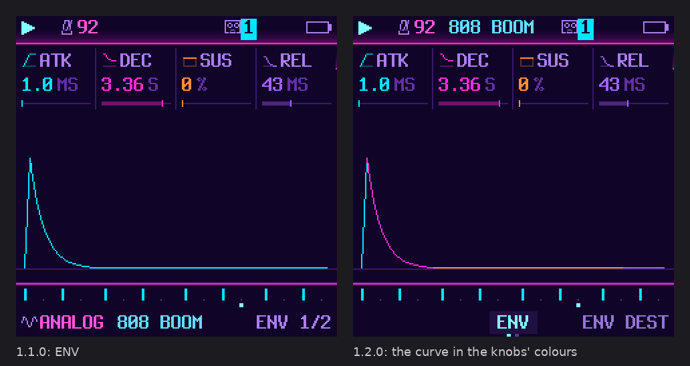
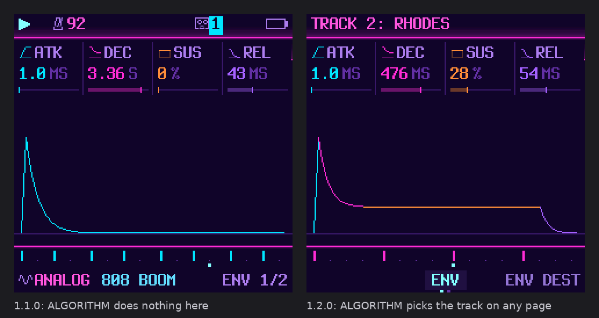
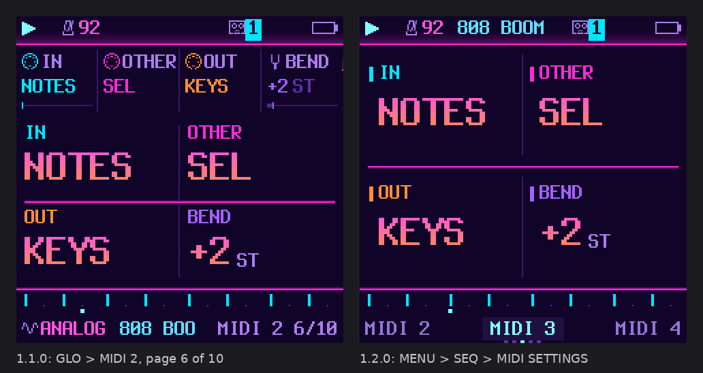
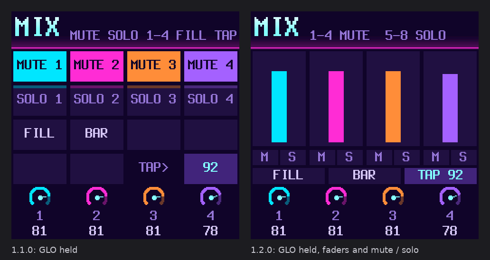
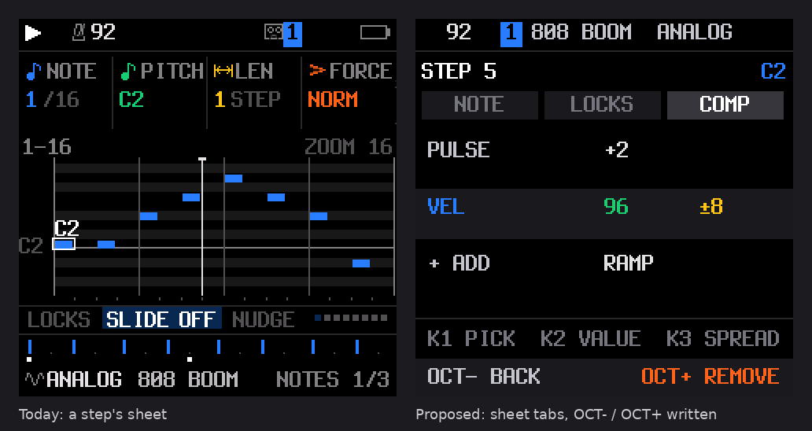

# BoopBox UX review: the screen, the knobs and the buttons

> **About this page.** This is a historical record of the review for BoopBox 1.2.0. The pictures show the screens of
> 1.1.0 (left) and 1.2.0 (right). They do not show the screens of later versions. The column "In 1.9.3" in the table
> below gives the status in BoopBox 1.9.3. The status comes from the firmware source and `CHANGELOG.md`.

This review looks at BoopBox on the FM-1. It finds what is cluttered or hard to find. It tells what to change and what
to keep. It looks at each screen as the firmware draws it (`assets/screens/all/`, `tools/make_all_screens.py`). It also
looks at the code of the firmware and at the hardware.

**BoopBox 1.2.0 builds most of the changes.** Each picture is a drawing by the firmware, in the SYNTHWAVE colors.
1.1.0 is on the left and 1.2.0 is on the right. **[Every screen, before and after](before-after-all.png)** is one large
image of all 111 screens.

## What 1.2.0 changed

| # | Change | In 1.2.0 | In 1.9.3 |
|---|---|---|---|
| 1 | **One page template:** four values in the corners of the knobs, shown once. The pages of a family show as tabs. The sound is in the header. | **built** | **built** for the value pages. Pages with a graph or a list (for example ENV, LFO, FX, SEQ > NOTES and SAVE > SECTION) keep the four knob columns at the top. |
| 2 | **Device settings out of GLO:** MIDI, MIDI 2–4 and SYSTEM are on their own pages, which open from the menu | **built** (MENU → SEQ → MIDI SETTINGS) | **built.** The path is the same: hold HOME, SELECT to SEQ, PRESETS to MIDI SETTINGS, then OCT+. |
| 3 | **Fewer pages for each button.** No setting is on two pages. | **built** for GLO (10 → 5) and FX (8 → 7). No setting is on two pages. | **built.** GLO has 5 pages and FX has 7 pages. |
| 4 | **ALGORITHM selects the track on every screen,** and the screen tells which track | **built** (the header names it) | **built.** 1.4.2 added the DRUMS screen. Exceptions: the SONG screen, a free take, and the sound browser (1.9.3). |
| 5 | **Fixed knob roles** (KNOB 1 the choice, KNOB 4 the amount) | not changed: see below | **not changed** |
| 6 | **Name what OCT− and OCT+ do** where they do not change the octave | **built** for the step sheet on NOTES | **partly built.** 1.7.0 added the labels to PATTERNS, CHAIN and SCENES. The sheet of the DRUMS grid has no labels. |
| 7 | **One way to confirm** a destructive action | changed: the knob prompts say *TURN AGAIN* | **partly changed.** Some newer prompts say *AGAIN* only: see [Knob confirmations](#knob-confirmations). |
| 8 | **The step sheet in tabs,** with the white keys as a component palette | not changed: see below | **not built** |
| 9 | **GLO held shows faders** | **built** | **built** |
| 10 | **A help overlay** | not built: no space in the flash | **not built** |
| — | Whole words: labels and values are not cut at five letters (*TARGE MASTE* → *TARGET MASTER*) | **built** | **built** |
| — | The ENV curve in the colors of its knobs | **built** | **built** |

In 1.2.0, the firmware was 1,992 B larger than in 1.1.0. 1,812 B of the app slot stayed free
(`docs/groovebox-performance.md`). These numbers are for 1.2.0 only.

### Value pages: every value once, in the corner of its knob

1.1.0 had 29 pages without a graph. On these pages, it drew the four values two times. They were small in columns
along the top, and large in a 2 × 2 grid below. 1.2.0 draws them one time, large, from immediately below the header.

The positions are as the knobs: KNOB 1 is at the top left, and KNOB 2 at the top right. KNOB 3 is at the bottom left,
and KNOB 4 at the bottom right. Each label is in the color of its knob, with a short bar next to it. The footer does not
show the engine and the sound again. They are in the header, one time.

### Page tabs

The second row of the footer shows the name of the page. The page before and the page after it are on the left and
the right. These are the pages that SELECT, or the same button again, opens. Below the name, there is one dot for each
page of the family. The dot of the current page is lit. This replaces *OSC 1/5* and the cut engine and preset names
(*ANALOG 808 BO*).

### Whole words

In 1.1.0, `fit()` cut all labels and all named values to five letters, also when there was more space. Examples are
*TARGE*, *MASTE*, *FOLLO* and *DR MA*. Now, the large values keep up to eight letters. Only the real space cuts them.

### The ENV curve in the colors of its knobs

The graph draws the attack in the color of KNOB 1 and the decay in the color of KNOB 2. It draws the sustain in the
color of KNOB 3 and the release in the color of KNOB 4. Thus, the graph is its own legend.

### ALGORITHM on every page

In 1.1.0, ALGORITHM changed the track only on TRACKS, PATTERNS and CHORDS. On other screens, a turn did nothing. To go
from the envelope of track 1 to the envelope of track 3, you pressed HOME, then turned ALGORITHM, then pressed ENV.

In 1.2.0, ALGORITHM changes the track on all pages. The page stays. The header shows *TRACK 3: LOFI FLUTE* for a short
time. Thus, you can see an accidental turn, and one detent back reverses it. During a free take, ALGORITHM does
nothing.

Changes after 1.2.0:

- 1.4.2: ALGORITHM also changes the track on the DRUMS screen.
- 1.9.3: in the sound browser, ALGORITHM moves through the sounds of the engine. It does not change the track there.
- The SONG screen keeps ALGORITHM for the start of its loop.

### The MIDI setup out of GLO

In 1.1.0, GLO had ten pages. These pages mixed two types of settings:

- Settings that you change while you make music: tempo, swing, the master filter, the drum mix and the texture.
- Setup that you do one time: MIDI channels, MIDI IN and OUT, the clock, and the MIDI channel for the punch-in FX.

Some settings were on two pages. MIDI IN and OUT were on SYSTEM and on MIDI 2. The drum channel was on DRUMS and on MIDI.

In 1.2.0, GLO has five pages: GLOBAL, MASTER, DRUMS, TEXTURE and TEXTURE 2. The setup has its own five pages.

To open the MIDI pages in 1.9.3:

1. Hold HOME to open the menu.
2. Turn SELECT to the SEQ section.
3. Turn PRESETS to put the cursor on MIDI SETTINGS.
4. Press OCT+.

| Page | Settings |
|---|---|
| MIDI | CH1, CH2, CH3, CH4 (the drums) |
| MIDI 2 | CH5–CH8 |
| MIDI 3 | IN, OTHER, OUT, BEND |
| MIDI 4 | FX CH, DR MAP, REMOTE, CLOCK |
| SYSTEM | SYNC, USB |

SELECT moves through these pages, and the GLO light stays on. Each global setting is on one page only. A test makes
sure of this.

### FX: INSERT 2 moved into FILTER

INSERT 2 was a page with one value: the dry/wet mix of the insert. This value is now next to the track filter, on
FX → FILTER. Thus, FX has seven pages.

### GLO held: a mixer that you can read

In 1.1.0, the GLO layer showed mute, solo, fill, bar and tap as a grid of 4 × 4 tiles. Now, it shows the four levels
of the bank as faders. Muted faders are dim. Mute and solo are below each fader. FILL, BAR and the tap tempo are below
them.

The keys are the same as before:

| Keys | Function |
|---|---|
| 1–4 | mute |
| 5–8 | solo |
| 9 | fill |
| 10 | fill on the next bar |
| 16 | tap tempo |

The knobs still set the levels.

### What OCT− and OCT+ do in the step sheet

The step sheet is on NOTES, while OCT+ is held. In the sheet and in its LOCKS and COMP strips, OCT+ does an action and
OCT− goes back. In 1.1.0, the screen did not tell this.

Now, while the sheet is open, the second row of the footer shows what each button does. Examples are
*OCT− CLOSE · OCT+ SLIDE*, *OCT+ COPY* and *OCT+ OPEN*. In the strips, the labels are *OCT− BACK · OCT+ ADD* or
*REMOVE*. These are soft-key labels. BoopBox uses these two buttons as soft keys.

In 1.9.3, the PATTERNS, CHAIN and SCENES pages (1.7.0) also show what OCT+ and OCT− do, in their bottom line. The sheet
of the DRUMS grid does not show these labels.

### Knob confirmations

Some settings act only on a second detent. In 1.2.0, these settings show *TURN AGAIN: …*, not *AGAIN: …*. The settings
are CLRSQ, NEW, KIND, ERASE on SECTION, GO of the user presets, and CLEAR and COPY on PATTERNS. You cannot hold a knob.
Thus, these settings keep the gesture of two detents. The prompt now tells which gesture to use.

In 1.9.3, these confirmations do not say *TURN AGAIN*:

| Prompt | Where |
|---|---|
| *COPY 1 > 4: AGAIN* | COPY (KNOB 3) on the PATTERNS page (1.7.0) |
| *AGAIN: DRUMS, PAT CLR* or *AGAIN: SYNTH, PAT CLR* | the sound browser, when the new sound changes the kind of the track |
| *AGAIN: A* to *AGAIN: D* | SAVE held, then key 5–8 (a key, not a knob), to store over a section that is not empty |

The CLEAR prompt on PATTERNS still says *TURN AGAIN*.

## What 1.2.0 did not change, and why

- **Fixed knob roles (5).** An audit found that most pages already have the main value on KNOB 1. If the other values
  move, all users must train their hands again, for a small gain. Now, pages that do not obey the rule show this
  with whole labels. Status in 1.9.3: not changed.
- **The step sheet in tabs and the white-key component palette (8).** This changes what the keys do on the NOTES page,
  where they enter notes. The OCT labels (6) correct the worst part: they tell what OCT+ opens. The palette is the next
  idea to try. Status in 1.9.3: not built.
- **Hold-to-confirm everywhere (7).** The *AGAIN* confirmations use knobs, and you cannot hold a knob. The hold ring of
  REC stays where a button does the action. Status in 1.9.3: not changed.
- **A help overlay (10).** Its text needs about 1 KB of flash, and 1.2.0 did not have this space. Status in 1.9.3: not
  built.
- **The dials at the top of the full screens.** TRACKS, PATTERNS, CHORDS, SONG, DRUMS and REC keep their knob dials at
  the bottom. To move them, six screens must be drawn again, for a small gain. Also, they are the same on all six
  screens. Status in 1.9.3: not changed.
- **Blue has two meanings.** KNOB 1 and track 1 have the same color. The track chip in the header helps. Knob colors that
  no track uses make it necessary to change every screen. Thus, this is a decision for the owner. Status in 1.9.3: not changed.

## What already worked, and stays

- **Layers.** When you hold a button, the keys and knobs change their function, and the screen shows how. The held
  button is the context, because the hardware has no shift button.
- **Undo and redo** (EDIT + OCT− / OCT+).
- **Hold REC until the ring fills** to clear a track.
- **Autosave,** and at power-on the FM-1 is as you left it.
- **The view of one drum sound** in the SEQ layer of the drum track.
- **Light as feedback:** the PLAY light on the beat, keys lit during play, and red for recording.
- **Recording without a click,** and free-tempo takes.

## The findings that started the review

These are the original findings. The review examined them again on the screens of 1.1.0, as rebuilt from main before
this change. These screens use SYNTHWAVE by default, and the PATTERN page of SEQ has the new name TIMING.

- **Every value two times** on 29 of 46 pages. **Five bands on 240 pixels**: the status bar, the columns, the values,
  the step marks, and a footer. The footer showed the track of the header again and cut names to fit.
- **Labels cut to five letters** by `fit()`. These were not intentional abbreviations.
- **Knob slots in different positions:** at the top of the parameter pages, and at the bottom of the full screens. The
  knobs of the FM-1 are level with the top of the screen.
- **46 pages behind 10 buttons.** GLO had ten pages and FX had eight. Some settings were on two pages. The screen showed
  the position in a family only as *MIDI 3 7/10*.
- **ALGORITHM worked on three screens only.**
- **Controls with a function that changes with the screen** (SELECT, SAVE, HOME, OCT+). The screen did not tell their
  current function. The screen must name the current function of each button.
- **Gestures that are hard to find.** To add a step component, you moved the cursor, held OCT+, turned KNOB 1 to the
  last row, and tapped OCT+.
- **The labels on the panel.** The black keys have the labels OP1–OP6, PIT, GLO, MONO and POLY, and one encoder has the
  label ALGORITHM. These are the functions of the stock firmware. Thus, the screen must be the label.

## Design principles for the FM-1

- **One screen for each module, four values, each in the color of its knob.**
- **Each parameter is at most two presses away,** and the screen names the pages of its button.
- **Graphics first.** Each part of a graph is in the color of its knob.
- **Press the same button again** for the next page or to toggle.
- **Hold a button as the modifier,** because the FM-1 has no spare buttons.
- **Soft-key labels** on the screen tell what the buttons do now.
- **Settings in columns:** one knob for the section, one for the item, one for the value. The menu of BoopBox already
  works this way.
- **Removes that you can undo, and one strong confirmation** for real deletes.

## Next

| # | Item | Status in 1.9.3 |
|---|---|---|
| 1 | The white-key component palette on the step sheet (8) | not built |
| 2 | OCT labels on the sheet of the DRUMS grid and on PATTERNS (6) | PATTERNS: built in 1.7.0. DRUMS grid sheet: not built. |
| 3 | Help on the device (10), when there is space in the flash | not built |

To make the screenshots for a change, run `python3 tools/make_all_screens.py`. The pictures on this page come from
`tools/ux-mockups/mock.py` and `tools/make_before_after.py`, with the gallery as it was before the change.
